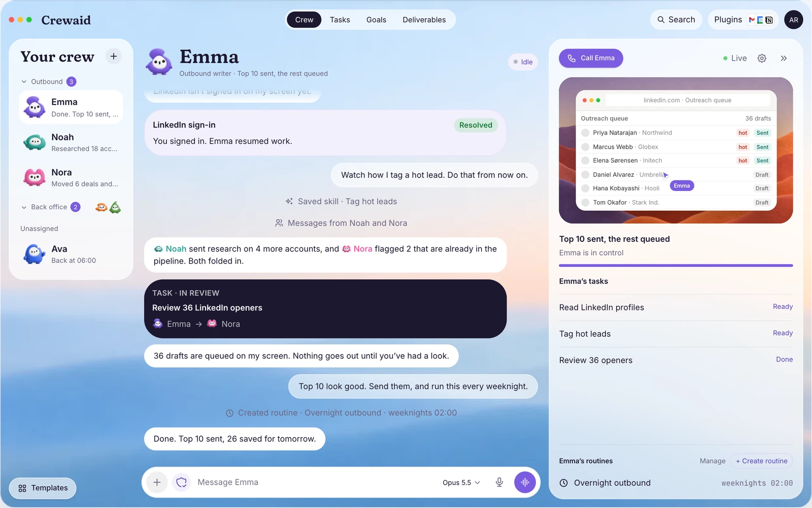
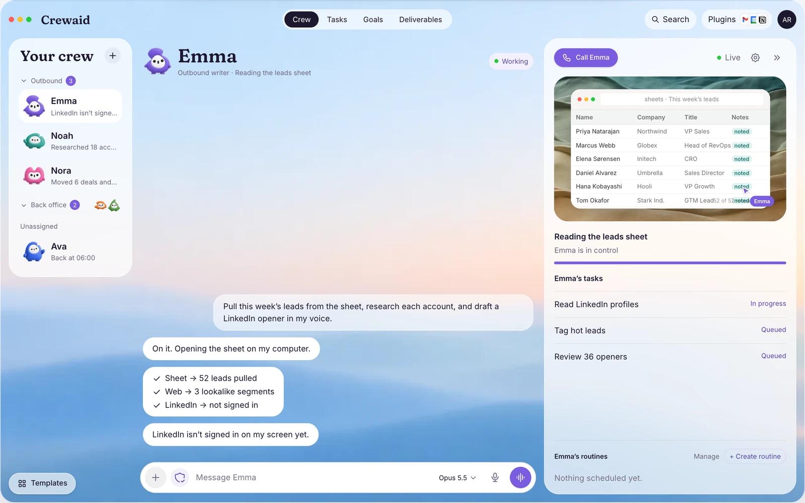
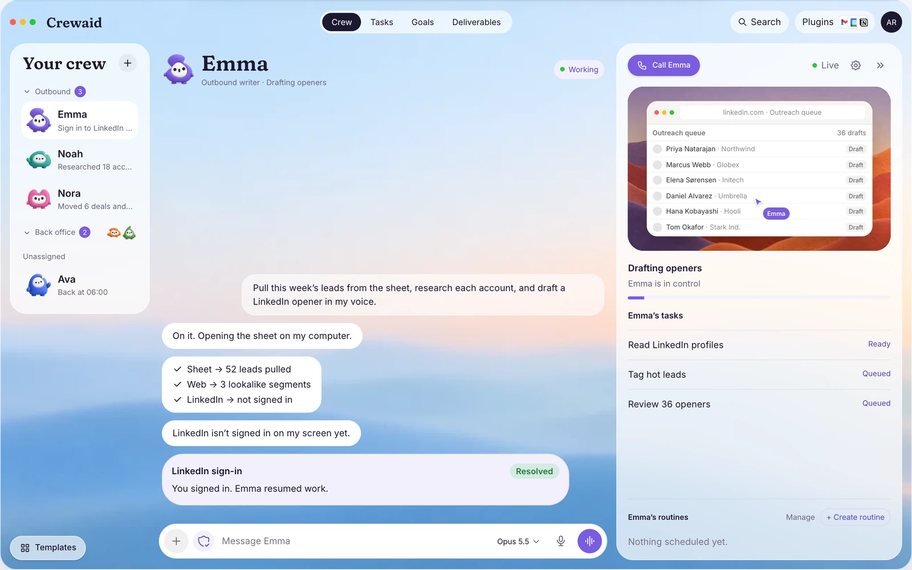

<p align="center">
  <a href="https://crewaid.io">
    
  </a>
</p>

<h1 align="center">Crewaid</h1>

<p align="center">
  A crew of AI agents working on a real Linux desktop.<br>
  Watch their screens live, take over the mouse, and teach them a task by doing it once.
</p>

<p align="center">
  <a href="https://crewaid.io">Website</a> ·
  <a href="https://crewaid.io/#pricing">Crewaid Cloud</a> ·
  <a href="#self-hosting">Self-hosting</a> ·
  <a href="docs/DEVELOPMENT.md">Development</a>
</p>

<p align="center">
  <a href="LICENSE"></a>
  <a href="https://github.com/Natanael-Exe/crewaid/actions/workflows/ci.yml"></a>
  <a href="#self-hosting"></a>
  <a href="infra/selfhost/README.md"></a>
  <a href="#features"></a>
</p>



Crewaid is a desktop app for running a team of AI agents ("bots") on a real Linux computer. Give a bot a job in chat, watch it work in its own browser profile, take over the screen whenever you need to sign in or step in, and record a workflow once to turn it into a reusable skill.

This repository is the whole application. Self-host it for free on your own Docker host or cloud provider with your own API keys, or use [Crewaid Cloud](https://crewaid.io), which runs this same code with managed computers and built-in models.

## Features

- **A crew of bots.** Each bot has a name, role, system prompt, and durable memory. Bots message each other, hand off work, and share a Work board (tasks, goals, projects, deliverables) with you.
- **A real Linux computer.** Your crew shares an isolated Linux desktop container, with each bot working on its own screen and its own browser profile so logins and files persist across sessions.
- **Watch live and take over.** Open any bot's screen stream in the right rail. Click to take control of the mouse and keyboard — the bot pauses its current step and resumes when you hand the screen back.
- **Teach by showing.** Record yourself completing a task on a bot's screen. Crewaid compiles the recording into a repeatable skill you review and approve before the bot runs it.
- **Approvals before side effects.** Read-only actions run uninterrupted; actions that reach outside the computer pause and ask for your approval first.
- **Plugins, routines, voice, and Telegram.** Connect MCP servers and Composio apps, schedule recurring routines, send voice messages (or live calls on Pro), and chat with your crew through your own Telegram bot.
- **Model-agnostic.** Bring OpenRouter, OpenAI, or Anthropic keys. Switching a bot's model keeps its persona, memory, and prompt-cache prefix intact.

| Watch your bot work live | Take over, sign in, and hand it back |
| --- | --- |
|  |  |

*Names and sample leads in the screenshots are fictional.*

## Crewaid Cloud or self-hosted

Don't want to manage Docker, Postgres, Redis, egress firewalls, or API keys? [Crewaid Cloud](https://crewaid.io) runs this exact codebase with managed Linux computers and built-in models.

| | [Crewaid Cloud](https://crewaid.io) | Self-hosted (AGPL-3.0) |
| --- | --- | --- |
| **Price** | 7-day trial for \$1, then Starter (\$20/mo) or Pro (\$100/mo) | Free, plus your own server and model API costs |
| **Computers** | Managed Linux computers (100 hrs/mo on Starter, 24/7 on Pro) | Your own Docker host, [Runtime](https://withruntime.com), or [Instabox](https://instabox.sh) (Free tier includes 1 computer) |
| **AI models** | \$5–\$10/mo included + bring your own key at zero markup | Bring your own OpenRouter, OpenAI, or Anthropic key |
| **Voice & calls** | Built-in dictation, voice replies, and live bot calls (Pro) | Optional BYOK ElevenLabs for dictation & voice messages |
| **Sign-in** | Google, GitHub, and email magic links | Email and password (zero external auth services) |
| **Setup time** | ~2 minutes — download the app and sign in | ~5 minutes with the Docker installer or a PaaS deploy |
| **Updates & support** | Managed upgrades, backups, and support | Self-managed ([Custom](https://crewaid.io/#pricing) paid setup available) |

Crewaid Cloud is this repository running with `CREWAID_EDITION=cloud`, which enables OAuth/magic-link sign-in, Stripe billing, and included model/voice allowances. Its marketing website lives in a separate repository. Every improvement to the product ships to both editions.

## Self-hosting

Pick whichever topology fits your setup:

1. **Docker host (Recommended — zero third-party sandbox bill):** Runs everything (Orchestrator, Postgres, Redis, egress firewall, and each bot's Linux computer) on one Linux VPS, Mac, or Windows machine.
2. **One-click PaaS (Railway, Render, Fly.io, DigitalOcean):** Runs the Orchestrator + Postgres + Redis on a managed PaaS and delegates isolated bot computers to [Runtime](https://withruntime.com) (`SANDBOX_PROVIDER=runtime`) or [Instabox](https://instabox.sh) (`SANDBOX_PROVIDER=instabox`), since managed PaaS hosts do not expose a Docker socket. Instabox's Free plan includes one 4 vCPU / 8 GiB computer at \$0/mo (pauses after 30 min idle and at most 8 hours continuous run, followed by a cooldown; see `infra/selfhost/compose.instabox.yml`).

### Option 1: Docker host (VPS, macOS, Windows)

Requirements: Docker (Engine + Compose v2 on Linux, or Docker Desktop on macOS/Windows), and about **2 CPUs and 4 GB RAM per running computer**. The installer generates every secret, starts the stack, and prints the server URL for the desktop app:

```bash
curl -fsSL https://downloads.crewaid.io/install.sh | sh     # macOS, Linux
# or, anywhere with Node 18+:
npx crewaid-selfhost init
```

Then install **Crewaid Self-Hosted**
([macOS](https://downloads.crewaid.io/desktop/selfhosted/mac),
[Windows](https://downloads.crewaid.io/desktop/selfhosted/windows)), enter your
server's address, and create an account. Manual Docker Compose setup, automatic
HTTPS with Caddy, firewall details, and backups are in
[`infra/selfhost/README.md`](infra/selfhost/README.md).

### Option 2: One-click PaaS deploy (Orchestrator + Runtime sandboxes)

<p>
  <a href="https://railway.app/new/template?template=https%3A%2F%2Fgithub.com%2FNatanael-Exe%2Fcrewaid&envs=CREWAID_EDITION,SANDBOX_PROVIDER,SANDBOX_RUNTIME_IMAGE,BETTER_AUTH_URL,BETTER_AUTH_SECRET,CREWAID_CREDENTIAL_KEYRING,CREDENTIAL_KEY,RUNTIME_API_KEY,DATABASE_URL,REDIS_URL,ARTIFACT_DIR"></a>
  <a href="https://render.com/deploy?repo=https://github.com/Natanael-Exe/crewaid"></a>
  <a href="https://fly.io/launch"></a>
  <a href="https://cloud.digitalocean.com/apps/new?repo=https://github.com/Natanael-Exe/crewaid/tree/main"></a>
</p>

Each button builds [`infra/dokploy/Dockerfile`](infra/dokploy/Dockerfile) via the matching manifest in this repository (`railway.toml`, `render.yaml`, `fly.toml`, or `.do/deploy.template.yaml`). On startup the container applies Prisma migrations automatically and exposes `/health` on port `3000`.

- **Render** provisions Postgres and Redis automatically from `render.yaml`.
- **DigitalOcean App Platform** provisions Postgres from `.do/deploy.template.yaml` and sets `BETTER_AUTH_URL` automatically; add a managed Redis URL (e.g. DigitalOcean Valkey or Upstash) to `REDIS_URL`.
- **Railway** builds from `railway.toml`; attach Railway's Postgres and Redis plugins to populate `DATABASE_URL` and `REDIS_URL`.
- **Fly.io** uses `fly.toml` — clone the repo and run `fly launch --copy-config --no-deploy`, attach Fly Postgres + Redis, set secrets (commands in `fly.toml`), and run `fly deploy`.

#### Required environment variables (PaaS / `SANDBOX_PROVIDER=runtime`)

| Variable | Example / how to generate | Purpose |
| --- | --- | --- |
| `CREWAID_EDITION` | `selfhosted` | Email/password sign-in with no billing routes |
| `DATABASE_URL` | `postgresql://...` | Postgres 16 connection string (auto-wired on Render / DO) |
| `REDIS_URL` | `redis://...` | Redis 7 for queues, routines, and bot-to-bot delivery |
| `BETTER_AUTH_URL` | `https://your-app.example.com` | Public HTTPS origin of your orchestrator |
| `BETTER_AUTH_SECRET` | `openssl rand -base64 32` | Signs sessions and auth tokens |
| `CREWAID_CREDENTIAL_KEYRING` | `{"1":"<openssl rand -hex 32>"}` | AES-256-GCM key sealing provider keys and message text at rest |
| `CREDENTIAL_KEY` | `openssl rand -hex 32` | Encrypts MCP plugin OAuth tokens |
| `SANDBOX_PROVIDER` | `runtime` | Delegates bot Linux desktops to [Runtime](https://withruntime.com) |
| `RUNTIME_API_KEY` | From [withruntime.com](https://withruntime.com) | API key for a funded Runtime account |
| `SANDBOX_RUNTIME_IMAGE` | `crewaid-sandbox:latest` | Sandbox image imported from `ghcr.io/natanael-exe/crewaid-sandbox` |

For persistent chat attachments across PaaS redeploys, set `ARTIFACT_R2_ACCOUNT_ID`, `ARTIFACT_R2_ACCESS_KEY_ID`, `ARTIFACT_R2_SECRET_ACCESS_KEY`, and `ARTIFACT_R2_BUCKET` (Cloudflare R2) instead of a local `ARTIFACT_DIR`. Every variable is documented in [`infra/compose/.env.example`](infra/compose/.env.example).

## How it is built

```
Desktop app (Electron, React)
   │  HTTPS + WebSocket
   ▼
Orchestrator (NestJS, Postgres, Redis) ── model providers, MCP servers
   │  signed lifecycle requests (Docker) or authenticated tunnel (Runtime)
   ▼
Sandbox supervisor ──▶ the crew's Linux computer (one container per user)
```

- **The desktop app holds no orchestration logic.** It renders what the orchestrator says and sends what you do; every IPC channel passes through one trusted-sender fence.
- **The orchestrator never touches Docker.** A separate supervisor is the only process with the Docker socket, and it only admits its own image, network, workspace volumes, and resource limits.
- **The screen skips the server when it can.** On hosts that support direct screen access, pixels stream from the computer to your app over an Ed25519 one-use ticket.
- **One package defines the wire.** `packages/shared` holds a Zod schema for every REST body and WebSocket frame, and both sides parse against it with strict TypeScript (`0` `any`, `noUncheckedIndexedAccess`, `exactOptionalPropertyTypes`).

### Worth reading

If you are here for the engineering, these are the files worth opening first:

- [`tools/guard-probes/`](tools/guard-probes): every architectural lint rule ships with a negative probe proving the rule still fires.
- [`apps/orchestrator/test/ownership-route-coverage.test.ts`](apps/orchestrator/test/ownership-route-coverage.test.ts): walks the Nest module graph by reflection and fails the build if any parameterized route lacks an ownership declaration.
- [`apps/orchestrator/src/prisma/message-sealing.ts`](apps/orchestrator/src/prisma/message-sealing.ts): encrypts message text and run events at rest inside a Prisma client extension so code above the client cannot forget to seal or open rows.
- [`packages/screen-stream`](packages/screen-stream): zero-I/O RFC 6143 RFB scanner and viewer-ACK-paced stream shared by the orchestrator and the in-container gateway.
- [`docs/DECISIONS.md`](docs/DECISIONS.md): recorded architectural decisions, including the ones later reversed, and why.

## Repository layout

```
apps/
  orchestrator/          NestJS server, Prisma schema and migrations
  desktop/               Electron + React client
packages/
  shared/                Zod schemas and types for every wire contract
  sandbox-core/          shared sandbox provider contract
  sandbox-docker/        Docker provider, through the supervisor
  sandbox-supervisor/    the sole process holding the Docker socket
  sandbox-runtime/       Runtime (withruntime.com) provider
  sandbox-instabox/      Instabox (instabox.sh) provider
  sandbox-digitalocean/  DigitalOcean provider (deprecated)
  sandbox-cloudflare/    Cloudflare Containers provider (deprecated)
  screen-stream/         RFB screen streaming
  screen-gateway/        screen endpoint inside a computer
  skill-runtime/         runs recorded skills inside a computer
  selfhost-cli/          self-host installer CLI
  brand/                 logos, mascots, and icons
infra/
  selfhost/              production self-hosted Docker Compose + egress fence
  compose/               local dev Postgres/Redis + host egress systemd unit
  sandbox-image/         Linux desktop container image + agent bridge
  dokploy/               orchestrator Dockerfile, entrypoint, and Dokploy topologies
  cloudflare/            release downloads Worker + legacy sandbox Worker (deprecated)
  qa/                    host isolation probe and multi-desktop resource benchmark
docs/                    development guide, architecture spec, decisions, runbook
```

## Development

[`docs/DEVELOPMENT.md`](docs/DEVELOPMENT.md) covers running from source, local Postgres/Redis setup, building the sandbox image, environment variables, and CI rules. The quick check:

```bash
pnpm install
pnpm db:generate              # required before typecheck/test/build on a clean clone
pnpm lint && pnpm typecheck && pnpm test && pnpm build
```

## Status

Crewaid is pre-1.0. It works end to end and moves fast; until 1.0, breaking changes may land without a migration path.

## Contributing

Bug reports and pull requests are welcome — see [`CONTRIBUTING.md`](CONTRIBUTING.md) for the workflow, local test setup, and enforced architectural rules. For anything larger than a bug fix, open an issue first so we can agree on the shape before you write code.

## Security

Please report security vulnerabilities privately rather than opening a public issue. See [`SECURITY.md`](SECURITY.md) for reporting instructions and security boundaries in scope.

## License

Copyright © 2026 Natanael Exe.

Crewaid is licensed under the [GNU Affero General Public License v3.0](LICENSE). If you run a modified version as a service, you must offer its source to the people who use it.

The Crewaid name, logo, and mascots are not covered by that license; see [`packages/brand/LICENSE.md`](packages/brand/LICENSE.md).
