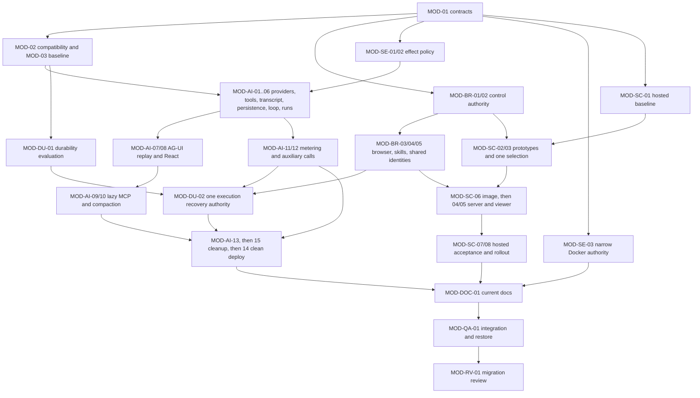

# Architecture modernization implementation handoff

Planned on 3 October 2026 from `origin/main` at `961c9278ba392fcd91c5f66e2fb96ad7c3ab336b`. D-158 ratifies this program. All new tasks start in **backlog**: this PR implements the plan/board, not the product migrations. Estimates are provisional person-days; owners use the board's existing roles, and any implementation model can take the next eligible task in an isolated worktree.

`tasks.json` is authoritative. This handoff supplies scope and completion evidence; `TASKS.md`, `tasks.csv` and `board.html` are regenerated views. Read `CLAUDE.md`, `docs/TEAM.md` and current decisions first. A task is eligible only when every dependency is done; list order does not grant permission to skip dependencies. Existing completed milestone tasks remain done. M9 and office work keep their own release gates.

## Pre-launch scope: clean replacement

The user confirmed on 3 October 2026 that the product has not launched and has no users or production data. Major architecture, API, schema and browser-runtime changes are acceptable. Implement one target stack with matching server/client/image versions and fresh database/queue/computer setup. Explicitly selected disposable development/test state may be reset/reseeded through the documented workflow.

Do not build old-history converters, customer backfills, mixed-version readers, old-client support windows, dual SDK/streamer implementations, canary rollout infrastructure or deployment rollback rehearsals. Remove replaced code once target behavior is verified. Baselines compare useful product behavior/performance; they do not require preserving obsolete wire/storage representations. Task IDs stay stable so cross-references remain valid, while former migration/rollback tasks now define target schemas, cleanup and clean installation.

Still verify normal operation after launch: transaction failure isolation, reconnect/replay, pending approvals after restart, worker fencing, external-action reconciliation, shared-profile persistence and backup/host-loss restore using newly created target-state fixtures. These are runtime correctness requirements, separate from reverting an old deployment. Security, performance, contractual approval of new shapes and the shared-computer requirement continue to apply. This scope does not perform any database reset in the planning PR.

## Required result and retained foundations

Adopt TanStack AI on the backend **and** its headless React conversation state, native AG-UI, Prisma-backed persistence, lazy MCP and compaction where they replace generic mechanics. Keep NestJS, Prisma/PostgreSQL, Better Auth, HeroUI, existing provider seams and BullMQ scheduling. A queue-backend or workflow-library prototype is a decision gate, not a mandate to replace a working dependency.

Keep one shared computer per user by default with a private browser/Chrome profile, workspace, X display, WM/session bus and screen for every bot. Named shared logins are exclusively leased full Chrome user-data directories; they are transferred after browser exit, never opened concurrently by multiple Chrome processes. This preserves reusable login without promising concurrent independent copies of one mutable identity or hostile isolation between same-user, same-UID bots. Customer computers remain separate trust domains.

The reported performance target is the **expanded screen during manual control on a hosted/remote server**. Keep the full desktop and demonstration recording. TanStack/AG-UI does not pace pixels. Benchmark KasmVNC first and Selkies as an alternative, then integrate one selected path. Browser-only CDP video or four-second screenshot polling cannot meet the full-desktop requirement. Avoid implementing both a major custom RFB rewrite and a replacement streamer.

## Source of recommendations

- [OpenDots architecture review](../research/OPENDOTS-ARCHITECTURE-REVIEW-2026-10-03.md): browser targeting/control, effect policy, durability, privileged Docker boundary, Markdown, dependency and product patterns. Its original SDK recommendation is superseded by the next report and D-158.
- [TanStack AI versus AI SDK](../research/TANSTACK-AI-VS-AI-SDK-2026-10-03.md): source/published API comparison, native frontend/backend migration, Prisma message/run/interrupt mapping, provider/usage differences and durable replay boundaries.
- [Bot screen streaming review](../research/BOT-SCREEN-STREAMING-REVIEW-2026-10-03.md): current RFB/pong/tunnel pipeline, OpenDots/OpenBot differences, image/security limitations and benchmark candidates.

The reports pin inspected upstream revisions and distinguish source inference from runtime tests. OpenDots is an early alpha whose security statement disclaims an audit; popularity is not production assurance. Candidate packages/versions are research snapshots. MOD-02 and MOD-SC-02 reverify exact compatible releases, interfaces, runtime support and licenses before adoption. No upstream default root/disabled Chrome sandbox is copied.

## Execution order and decision gates

Start with MOD-01, then dependency-ready contract/baseline work. The graph has separate tracks so a screen benchmark does not wait for chat migration and chat does not wait for the screen winner. When using one implementing model, finish one eligible task and its checks before selecting the next. After each PR merges, take a fresh base, preserve task IDs, update only actually achieved statuses and regenerate views. Do not auto-create or start runtime Work tasks because this development board changed.

The diagram summarizes tracks; exact prerequisites are the task graph below. Before core changes, MOD-01 ratifies wire/event/table/config names and target representation and fresh-setup policy. MOD-BR-01 and MOD-SE-01 ratify domain semantics; MOD-SC-03 ratifies the selected media contracts. The initial choices in D-158 authorize these decisions, not guessed API shapes.

Durability has three separate proofs: stored transcript/interrupt state (MOD-AI-04/06), replayable delivery (MOD-AI-07), and producer/action recovery with reconciliation (MOD-DU-02). An event replay does not restart a dead model producer or bill again. A checkpoint cannot prove an arbitrary external write happened exactly once; uncertain writes require reconciliation or an explicit unresolved/manual outcome. Browser/model/socket objects are reconstructed from serializable IDs, not stored as durable values.

## Definition of done and evidence

Each task must provide a focused diff, contract/guard changes where required, meaningful regression cases, actual command/results and limitations. Use existing suites and package conformance tests rather than mirrors of implementation. Store evidence under a ratified location/naming policy in MOD-01; record inspected/deployed refs, image/browser digests, provider/model, editions, fixtures, test prerequisites and pass/fail/skips. Run required pre-review checks before requesting implementation review; mocked/unit success never substitutes for Postgres, hosted-screen or real-provider gates.

Clean chat deployment requires intended behavior for every inventoried consumer, server-owned canonical messages, matching current server/client versions, transactional persistence, interrupts after restart, fenced writers, charge reservation/settlement and provider capability/error normalization. Native standard AG-UI compatibility is tested separately from TanStack extension support. No renderer model credentials or server-only packages are permitted. Preserve read markers, topic boundaries, attachment claiming, Work/task/routine/deliverable provenance and memory reset/forget semantics.

Screen selection requires baseline-derived numeric budgets for interaction p50/p95, readable text, cadence/frame age, memory/queue bounds, CPU/throttling and bytes. Measure both feedback loops (capture to orchestrator, orchestrator to viewer), clock-offset handling and decoder presentation rather than treating automatic pong as render completion. Use isolated network shaping; do not impair production networking. Validate controller/observer independence, late viewers, two displays, expected multi-bot load, held input, revocation, recording and hosted tunnels. WebRTC is a later connectivity experiment only if a measured need justifies ICE/TURN and provider UDP work.

Delete replaced SDK/parser/streamer paths after their target acceptance checks pass, before packaging the clean target deployment. No legacy fallback or deployment rollback implementation is required. Test database transaction failures and ordinary profile restart/restore behavior against newly created target data. Optional evaluations MOD-OP-01/02 do not block MOD-RV-01 and an evidence-backed defer can complete an evaluation. If a prototype needs a product scope change, ratify a follow-up instead of silently shipping it. M9/office/privacy gates are not satisfied by MOD-RV-01.

## Recommendation coverage and scope decisions

| Review recommendation or risk | Task home / decision |
| --- | --- |
| Native TanStack backend and headless React, AG-UI version/extensions, no duplicate frontend authority | MOD-01/02, MOD-AI-01/02/05/07/08/13/14/15 |
| Prisma lifecycle with canonical rich relationships, target schema, authoritative load/full save, edit/clear races | MOD-AI-03/04; CC-74/75/76 remain encryption/region/report owners |
| Durable run and interrupt resume; batch atomicity; active-owner locks; startup fence | MOD-AI-06, MOD-DU-01/02; M9-BE-05 commercial fault acceptance |
| Durable stream replay is distinct from execution; retention/owner/revocation/offset/version behavior | MOD-AI-07; M9-BE-01/04 and CC-74/75/76 |
| Provider parity, runtime capabilities, cache accounting, guarded endpoints, error redaction | MOD-AI-01/11/12/13; M9-BE-02/06 |
| All inference consumers including skills/memory, not just ToolLoopAgent | MOD-01 inventory, MOD-AI-12/15; preserve independent sandbox harness seam |
| Lazy MCP/direct discovery, managed lifecycle, reauthorization after revoke, input/Apps compatibility, real token budgets | MOD-AI-09; M10-CO-01 retains its Work budget/capability decision |
| Context compaction without losing full transcript, pending pairs, attachments or cached prefix | MOD-AI-10; preserve D-072/D-094 |
| Playwright locators/waits and observed snapshot references; fresh recording/compiler/runtime agreement | MOD-BR-03/04 |
| Enforced human takeover across mutation paths, fresh observation, stale holder and honest timeout | MOD-BR-01/02; MOD-SC-04/05/07 |
| One user computer, private bot seats, reusable exclusively leased named identity, restore after crash | MOD-BR-01/05, MOD-SC-06; M9-BE-03/04 |
| External browser effects are not automatically contained; final-argument/revision authorization; prompt-injection trust | MOD-SE-01/02; V1-OFF-10 actual mail commit; MOD-DU-02 uncertain outcomes |
| Docker socket authority reduced to a narrow authenticated lifecycle service | MOD-SE-03; M9-BE-03 and self-host package verification |
| Replace handwritten streaming Markdown without relaxing link/resource/HTML security | MOD-MD-01; retain HeroUI/product-specific cards |
| Hosted expanded-screen lag, per-pong cadence, second tunnel feedback, slow observers, late joins and render feedback | MOD-SC-01/02/03/04/05/07 |
| KasmVNC versus Selkies, fixed per-seat displays, native input/recording/auth, bounded frame/decode queues | MOD-SC-02/03/04/05/06/07/08; one winner only |
| Image versions, browser compatibility, non-root/sandbox, shared memory/compositor/XDamage/base health | MOD-02, MOD-SC-06; measured tuning, no copied unsafe defaults |
| Durable-workflow library can replace generic recovery only after one real prototype | MOD-DU-01/02; DBOS first candidate, Temporal justified alternative, one authority |
| BullMQ PostgreSQL could simplify operations but is not durable-agent recovery | Optional MOD-OP-01; keep Redis until a separate migration decision passes |
| Public research via existing MCP, explicit third-party data flow and real fetch SSRF/resource guards | Optional MOD-OP-02; do not build a crawler by default |
| Tiptap, reviewed artifact revision, failed-draft preservation and save receipts | Extend V1-OFF-04/09/10; editor evaluated when office scope needs it, no parallel Deliverable store |
| Channels/Slack/voice adapters and learning platform | Defer to explicit feature demand; later one channel SDK reuses the same tenant/agent/approval services. No new voice/channel task or automatic executable learning publication in this migration |
| External coding-agent runtime and durable harness packages | Existing V2-03 only; per-user auth/permissions and persistent shared-computer compatibility must pass |
| Popularity/alpha security disclaimer, SQLite/sample scheduler/Intelligence licensing | Reference only. Keep Better Auth, Prisma/Postgres, BullMQ and owned transcripts; no Hono/Bun/ORM/auth rewrite or Intelligence purchase |
| Documentation drift and actual generic code/dependency removal | MOD-DOC-01, MOD-AI-15, MOD-SC-08 and gate evidence |
| Complete real-model references, tenant launch, backups, side-effect recovery, economics, legal/privacy | Existing CC-10, M10 reference, M9 tasks and CC-74/75/76/77 retain gates; MOD supplies reusable evidence, never marks them done |

## Existing backlog integration

These rows retain their previous status, owner and completed work. Added dependencies are intentional release prerequisites; historical M0–M10 task completion is not rewritten. M9 is still the conditional paid-launch gate. Modernization can be implemented while M9 remains open, so no MOD task depends on a future M9 release or a future office feature. This avoids a circular demand that the new primitive must wait for a product that needs it.

- **M9-BE-01**: Reuse MOD-QA-01 evidence and independently verify the new AG-UI request/replay/log ownership and selected media/native input paths. Revoked sessions, guessed run/thread IDs and provider tunnel access must fail; existing Better Auth is retained. Added prerequisites: MOD-QA-01.
- **M9-BE-02**: Cover TanStack provider clients and MCP pools after MOD-AI-01/09: rotating/deleting a connection invalidates cached adapters without leaking ciphertext/key material; no browser-side BYOK is introduced.
- **M9-BE-03**: Keep one user computer with independent bot seats and named login exclusivity. Reconciliation must use the selected image/display/media stack and narrow Docker lifecycle authority; confirm owner-fenced provisioning and hosted port tunnels. MOD-SC-06/08 and MOD-SE-03 provide components, not commercial sign-off.
- **M9-BE-04**: Restore message relationships, durable run/interrupt state, browser profiles and shared identity grants/leases onto a replacement computer; never revive stale control holders. Test selected image upgrade and retention/deletion of event logs, approvals, artifacts and credential/session material. Consume encryption/region decisions from CC-74/75. Verify restore using newly created target state; historical customer migration and old-image deployment rollback are outside scope. Added prerequisites: MOD-AI-04, MOD-BR-05, MOD-SC-06.
- **M9-BE-05**: Use MOD-DU-02 and MOD-AI-06 as the single recovery/interrupt authority; this task owns all-provider commercial fault acceptance and outstanding tool-specific reconciliation. Test worker start beside healthy work, crash at every external commit/checkpoint boundary, revoked ownership and duplicate BullMQ delivery. Do not add a second workflow engine or blindly retry uncertain GUI writes. Added prerequisites: MOD-DU-02.
- **M9-BE-06**: Require TanStack reservation/settlement parity from MOD-AI-11 before completion. Consume hosted multi-seat encode/browser cost evidence from MOD-SC-07; retain Stripe test-mode validation and current in-progress status rather than treating the SDK port as completed. Added prerequisites: MOD-AI-11.
- **M9-QA-01**: Rerun final commercial isolation/restoration/lifecycle checks on the migrated stack, using the reusable MOD-QA-01 evidence rather than mocked producer/stream success. Include screen native input authorization, durable approval consumption and replay without billing. Added prerequisites: MOD-QA-01.
- **M9-PD-01**: Use MOD-SC-01/07 and MOD-AI-13 measured WAN, CPU-only multi-seat, queue/storage/traffic and inference-cost data. Validate deployment-specific capacity; configured CPU/RAM caps are not reservations and neither SDK nor codec choice establishes plan economics.
- **M9-RV-01**: The modernization gate does not pass paid launch. Review its final supported-version/limit evidence alongside M9 checks. Existing CC-74/75/76/77 privacy/site/legal promises must be satisfied before a launch presents them as implemented. Added prerequisites: CC-74, CC-75, CC-76, CC-77, MOD-RV-01. The migration gate must pass before the migrated stack is released commercially.
- **CC-10**: Use current Better Auth and both D-152 editions instead of the obsolete singleton host/token setup phrase above. Reuse MOD baseline/final reference evidence when appropriate, but record its own real-model skills/MCP sign-off; do not mark it done because unit tests or a migration gate passed.
- **CC-74**: Coordinate ciphertext/history/search/distillation reads with MOD-AI-03/04 canonical transcript schema and full-snapshot reconciliation; compaction/replay logs and interrupts must not create an unreviewed plaintext copy. SDK migration does not satisfy this privacy promise.
- **CC-75**: Ensure MOD persistence/event-log/backup boundaries can resolve the customer region without global cross-region caches. Region implementation and onboarding remain here; the shared user computer is provisioned in the selected region.
- **CC-76**: Include scoped access to transcripts, replay logs, approvals, shared identities and audit/lifecycle records after MOD migration, with redaction and regional/retention truth. Keep this customer report distinct from developer telemetry.
- **V1-OFF-04**: Borrow OpenDots revision checks, failed-draft retention and idempotent local save receipts keyed to action provenance. Evaluate Tiptap OSS for editable artifacts and its extension licenses here, separately from Streamdown transcript rendering. Keep one Deliverable store; local-save receipts never prove an external send occurred once.
- **V1-OFF-09**: Reuse TanStack typed part/tool/interrupt rendering from MOD-AI-08 when integrated; preserve the artifact revision shown to the user and a failed edit draft rather than building another chat state system. A rich editor is feature-scoped, with server ownership/revision checks.
- **V1-OFF-10**: Use the shared external-effect policy in MOD-SE-02 and recovery/reconciliation primitives from MOD-DU-02, including edited approval arguments. This task remains the actual provider-specific draft-to-send implementation and verified exactly-one controlled-recipient outcome. Added prerequisites: MOD-SE-02, MOD-DU-02.
- **V2-OFF-08**: Reuse MOD-DU-02 run/interrupt/reconciliation primitives; extend M8 trigger behavior only under the existing event/notification contracts. M9-BE-05 retains broader paid-service reliability acceptance. Added prerequisites: MOD-DU-02.
- **V2-OFF-11**: Reuse MOD-AI-09 lazy MCP discovery before writing another deferred listing/tool router; grants and final execution authorization remain mandatory. Context compaction comes from MOD-AI-10. Added prerequisites: MOD-AI-09.
- **V2-03**: Evaluate TanStack specialized durable coding-harness runs here if useful, with provider permission and per-user runtime/auth checks. It is not the ordinary browser-tool producer recovery in MOD-DU-02 and does not replace the persistent shared computer by default.

## Task-by-task handoff

Board estimates are person-days, not calendar promises. The purpose, acceptance criteria and code map below are mirrored from the authoritative task notes. Paths in the code map are relative to the repository and, for server/renderer submodules, to their existing source directories.

### MOD-01 — Ratify the target architecture and clean pre-launch transition

Role: `paul` · Estimate: 1.5 person-days · Prerequisites: `M10-RV-01`, `M6-RV-01`, `M8-RV-01`

Inventory current SDK imports, WS frames, product message semantics, policies, provider seams and guards. Ratify the target AG-UI, persistence, interrupt/run, screen/input and port contracts before implementation. The user confirms no launched users or production data: breaking APIs/schema changes and coordinated server/client replacement are allowed, with disposable development/test state recreated explicitly. Keep shared user computers, private bot seats and exclusive named login leases. Accept: One target contract matrix covers every affected call site/schema, clean installation/reset procedure, edit/clear races, retention/encryption/region seams and guard updates. No historical data converter, customer backfill, old-client support window, parallel legacy backend or deployment rollback plan is required. Exact endpoints/events/tables/config remain deliberate decisions. Define evidence and baseline-derived acceptance budgets.

Code map: docs/DECISIONS.md; docs/PRD.md §§2–4; docs/WORKSPACE.md; packages/shared; agent/execution; scripts/check-pins.mjs; eslint.config.mjs.

### MOD-02 — Verify and pin a compatible dependency set

Role: `paul` · Estimate: 2 person-days · Prerequisites: `MOD-01`

Run a minimal Nest/Node/Electron integration using exact compatible TanStack core, React, provider, persistence, compaction and MCP packages, AG-UI, Playwright and Streamdown. Recheck published APIs/exports and runtime support; research versions are snapshots. Inspect licenses, packaged components and bundle boundaries. Keep SDK-specific authoring outside Zod-only shared contracts. Accept: Text, tool call, typed interrupt, history reload and cancel work across real server/client builds; standard AG-UI events pass an independent client fixture and unsupported extensions are documented. Version drift fixtures and pins fail on incompatible updates. Provider credentials and server dependencies never enter renderer output. Do not install alternative stacks just to evaluate them.

Code map: workspace package.json files; pnpm-lock.yaml; packages/shared/package.json; apps/desktop build; provider packages; dependency/license manifest.

### MOD-03 — Capture product regression fixtures and performance baselines

Role: `marc` · Estimate: 1.5 person-days · Prerequisites: `MOD-01`

Extend existing suites with representative transcript/provider/tool/usage fixtures and real-model reference scenarios. Include attachments, reasoning, approvals/denials, edited arguments, skills, memory, routines, Work, bot chains, cancellation and two users. Use disposable seeded state; characterize valuable product behavior rather than obsolete storage/wire encodings. Record deployed refs/image digests/test prerequisites. Accept: A reproducible evidence inventory maps intended behavior to later task tests, including topic boundaries, read markers, errors, cache usage, unsupported capabilities and disconnects. No legacy-history or old-client migration fixtures are needed. Ratify chat performance/cost targets before clean deployment; CC-10 and the open M10 scenario retain their own sign-off.

Code map: apps/orchestrator/test; apps/desktop/test; docs/reviews/M10-RV-01.md; CC-10 evidence; docs/research.

### MOD-BR-01 — Specify seat control, browser freshness and login lease contracts

Role: `paul` · Estimate: 1.5 person-days · Prerequisites: `MOD-01`

Specify a server-authoritative seat control state machine: close agent admission, drain admitted mutations, grant one human controller, then require fresh observation on handback. Cover named identity holders, browser replacement, disconnects, lease expiry and process restart. Enumerate all browser/desktop/skill/shell mutation paths and unsupported bypasses. Accept: Exact control/input/reference contracts and invariants are ratified in DECISIONS/shared fixtures. Observer membership grants no input authority. Draining timeout never claims exclusivity. Same-UID bots are documented as one user trust domain; no claim of hostile bot isolation. Browser/profile leases remain distinct from view subscriptions and approval records.

Code map: sandbox/identity.service.ts; agent/turn-browser.ts; screen/screen.service.ts; agent-bridge/seats.py; packages/skill-runtime; D-046/D-056/D-057/D-060/D-061.

### MOD-BR-02 — Enforce human takeover at every seat mutation boundary

Role: `john` · Estimate: 3 person-days · Prerequisites: `MOD-BR-01`, `MOD-03`

Implement the agreed control barrier in the shared seat/resource layer and enforce it at effective input/execution boundaries, including browser tools, desktop actions, recorded skills and supported shell automation. Fence replaced holders and late teardown, renew bounded leases, and release held input before loss of control. Keep observers independent. Accept: Takeover during a slow action drains safely; timed-out takeover is denied; agent mutation is refused while human control is active. Forged view-only input, stale sockets, duplicate acquire/release, restart and disconnect cannot drive the seat. Handback after human navigation invalidates old references and requires a new snapshot. Unsupported raw execution cannot silently bypass the advertised guarantee.

Code map: sandbox seat/identity services; agent tool admission; screen input; infra/sandbox-image/agent-bridge; desktop control/heldInput tests.

### MOD-BR-03 — Replace raw browser actions with Playwright and observed references

Role: `john` · Estimate: 3 person-days · Prerequisites: `MOD-02`, `MOD-BR-02`

Attach Playwright only to the authorized existing seat Chrome endpoint; keep lazy acquisition, private profiles and shared identity selection. Implement locators, actionability and bounded waits behind the existing browser seam. Return run/snapshot-generation-bound references and resolve those references for actions; invalidate on navigation, replacement and human control. Accept: Duplicate labels, disabled elements, frames, popups, page changes and a slow navigation are handled or refused clearly. Stale references never fall back to an invented first-match selector. A real logged-in seat survives reconnect and identity transfer; another bot/user Chrome is unreachable. Delete redundant CDP action machinery while retaining necessary capture seams.

Code map: agent/browser-page.ts; agent/browser-tools.ts; agent/turn-browser.ts; sandbox CDP target resolution; agent-bridge/seats.py.

### MOD-BR-04 — Replace skill browser mechanics and verify fresh teaching flows

Role: `john` · Estimate: 2 person-days · Prerequisites: `MOD-BR-03`

Replace the handmade Playwright-shaped skill browser implementation with the supported adapter and current selector/action contracts. Preserve reviewed publication and policy checks. Keep CDP recording correlation, seat-specific screenshots and bounded navigation/cancel behavior coherent with the new driver. Development recordings/skills may be recreated; no historical skill conversion layer is required. Accept: Record, compile, review and rerun a fresh browser demonstration on a new seat; include frames/popups, human handback, failure and cancellation. Generated skill contracts match the actual runtime. No hidden new browser/profile launch, lost recording event, wrong-display screenshot or approval bypass occurs. Delete obsolete browser/skill mechanics and stale fixtures.

Code map: packages/skill-runtime/src/browser.ts; skills/recording/compilation services; agent CDP capture; existing M3/M4 suites.

### MOD-BR-05 — Harden shared login handoff and profile lifecycle

Role: `paul` · Estimate: 2 person-days · Prerequisites: `MOD-BR-04`

Reuse the existing identity service and bridge profile exclusivity; close race/restart gaps rather than creating another lease authority. Transfer a named live Chrome user-data directory only after the previous browser has exited. Fence stale holders, preserve private defaults and user ownership, and make login contention understandable in the UI. Accept: Two bots can operate private seats concurrently; two bots requesting one named identity serialize without profile corruption. Test simultaneous acquire, crash during handoff, browser replacement, stop/start, revoked grants and disconnect. Document same-user file trust and site-specific session limits. Restore/deletion cases feed M9-BE-04 instead of duplicating its backup implementation.

Code map: sandbox/identity.service.ts; bridge seats/profile lifecycle; renderer identity controls; docs/WORKSPACE.md; M9-BE-04.

### MOD-SE-01 — Ratify external-effect policy and untrusted-input boundaries

Role: `paul` · Estimate: 1.5 person-days · Prerequisites: `MOD-01`

Replace the assumption that every browser mutation is contained with an explicit policy for supported external commits. Define read/draft/commit/unknown effects, account/destination/content revision binding, final-argument validation and operator approval modes. Define conservative behavior for arbitrary authenticated sites, scripts and MCP tools without claiming perfect click classification. Accept: DECISIONS resolves D-092/D-144 changes and maps every mutation path. Web/page/file/email/tool output remains untrusted data; client tools/history/properties cannot grant capability. Approved actions are invalidated by changed arguments/content, destinations or grants. FULL access remains an explicit choice; prompt instructions alone are never the enforcement mechanism.

Code map: agent/auto-review.ts; tool registry; browser tools; MCP policy; D-092/D-108/D-144; V1-OFF-10.

### MOD-SE-02 — Enforce revision-bound policy across all execution paths

Role: `john` · Estimate: 3 person-days · Prerequisites: `MOD-SE-01`, `MOD-BR-03`

Implement one allow/deny/ask policy service at actual execution boundaries for browser, shell, skill and MCP actions, including known service commit adapters. Revalidate edited arguments, resource/account grants and approved revision immediately before dispatch; store reviewable proposals and outcome identities through agreed contracts. Reuse existing approval infrastructure. Accept: Tests reject stale approval, altered destination/content, revoked access, forged tool results and untrusted instructions attempting a send/publish/delete. Read/draft flows remain usable and FULL mode behavior matches the ratified choice. Unknown browser commit behavior is explicit. V1-OFF-10 supplies the full mail-provider send workflow; do not build a second mail or approval subsystem here.

Code map: agent tool binding/auto-review; skills execution; mcp tool execution; messages approvals; browser/desktop admission; V1-OFF-10.

### MOD-SE-03 — Move Docker authority into a narrow lifecycle service

Role: `paul` · Estimate: 3 person-days · Prerequisites: `MOD-01`

Ratify and implement a narrow authenticated supervisor behind the Docker sandbox provider. Remove the Docker socket from the main self-hosted orchestrator. Admit only owned resources, fixed verified images, approved mounts and bounded resource settings; derive scoped computer credentials and audit lifecycle actions. Preserve hosted provider interfaces. Accept: Create/start/stop/reconcile/delete and self-host installer/update flows work without an orchestrator host socket. Foreign resource labels, arbitrary images, host mounts, generic exec/create specs, replayed requests and master-token leakage are refused. Supervisor outage fails safely and can reconcile after recovery. Update R2 allowlists with a failing probe, packaging, private network and rotation/upgrade docs.

Code map: packages/sandbox-docker; infra/selfhost/compose.yml; self-host installer/release workflows; sandbox provider seam; eslint guards/probes.

### MOD-AI-01 — Build scoped TanStack provider adapters and normalize capabilities

Role: `john` · Estimate: 2.5 person-days · Prerequisites: `MOD-02`, `MOD-03`

Implement SDK-neutral resolved-model and error boundaries with TanStack OpenAI, Anthropic, OpenRouter/custom-endpoint adapters. Preserve encrypted server-side BYOK, guarded endpoint fetch/redirect/DNS rules, catalog caching and one resolved model per turn. Normalize usage fields semantically, including cached/fresh input and unknown versus zero usage. Accept: Each supported provider passes text/tool/reasoning/multimodal/cancel fixtures or reports a documented unsupported capability. Custom/private endpoints and credential leaks are refused. Anthropic fresh100/write200/read300 maps to the established 600-input contract, not promptTokens100. Errors remain D-006 safe and dynamic model selection is validated at runtime.

Code map: models/provider-factory.ts; model-resolution.service.ts; normalize-error.ts; agent/execution; existing provider/usage fixtures.

### MOD-AI-02 — Bind neutral tool contracts to TanStack and the policy service

Role: `john` · Estimate: 2.5 person-days · Prerequisites: `MOD-AI-01`, `MOD-SE-02`

Derive server/client TanStack tool definitions from shared neutral Zod schemas, keeping server implementations and credentials out of Electron. Preserve tool IDs, validated outputs, timeout/cancel, lazy computer acquisition and allow/deny/ask behavior. Map typed approval/interrupt states without reducing policy to a static needsApproval boolean. Accept: Built-in and selected MCP tools accept/reject the same fixture arguments and yield validated results. Final edited arguments are reauthorized; fabricated client tools/forwarded properties confer no authority. Computer tools observe control leases. Routines, bot chains and Work budgets/semantics survive; exported wire schemas keep valid/invalid fixture pairs and shared remains Zod-only.

Code map: agent/tool-registry.ts; built-in tool definitions; agent/execution ports; packages/shared schemas; renderer tool cards; TurnPlugins.

### MOD-AI-03 — Define canonical transcripts and the target persistence schema

Role: `paul` · Estimate: 1.5 person-days · Prerequisites: `MOD-01`, `MOD-02`, `MOD-03`

Choose one validated canonical representation for product messages and TanStack model/UI parts, with product-rich parts and finish reasons retained. Update Prisma/shared/schema contracts together and keep the migration journal consistent for fresh database creation. Disposable development/test databases can be explicitly reset/reseeded; no AI SDK history converter, old-format readers, backfill or mixed-version data path is required. Never cast Prisma JSON to wire types. Accept: Fresh-schema fixtures round-trip text, reasoning, tool call/result pairs, approvals, attachments and interrupted/failed turns with stable IDs/order/provenance within the new application. Topic boundaries, read markers, task/routine/deliverable references and memory semantics are correct. Clean install and the documented dev/test reset produce the target schema/seed; unrelated databases are not reset.

Code map: apps/orchestrator/prisma/schema.prisma; messages services; history seed/context; desktop/viewTypes; schema-contract.test.ts; Prisma JSON boundaries.

### MOD-AI-04 — Implement TanStack message persistence through the existing Prisma client

Role: `john` · Estimate: 2.5 person-days · Prerequisites: `MOD-AI-03`

Implement defineAIPersistence/defineMessageStore loadThread/saveThread using the existing Conversation/Message records and one Prisma service. Authorize conversation ownership before every operation; use server-authoritative history. Reconcile a full saved message snapshot transactionally, retaining product relationships and stable IDs instead of blind delete/recreate. Accept: Adapter conformance and real-Postgres tests cover new/existing threads, concurrent saves, empty saves, transaction failure, owner denial and stale writers. Clear/edit/regenerate are explicitly authorized and cannot let arbitrary client history truncate server state. Attachment claiming, read state, task/routine provenance, deletion and encryption/region extension points survive; R7 allowlist and migrations are updated.

Code map: prisma/schema.prisma; prisma.service.ts; messages/messages.service.ts; conversations; attachment/work relations; @tanstack/ai-persistence store conformance.

### MOD-AI-05 — Implement one TanStack backend execution path

Role: `john` · Estimate: 3 person-days · Prerequisites: `MOD-AI-01`, `MOD-AI-02`, `MOD-AI-04`

Run chat() through the existing execution seam with library-owned iteration/event mechanics and persistence lifecycle. Preserve bot identity/instruction order, memory-last cached prefix, stop conditions, cancellation, tool policy, step checkpoints and safe errors. Restrict the first comparison path to controlled accounts/BYOK until billing and recovery parity pass. Accept: A real provider performs text, one read tool, one reviewed write, denial, edited approval and cancellation against the baseline. Text/API work does not wake Chrome; computer work uses the correct seat. USER/BOT promotion is once, terminal states and finish reasons are correct, and background execution does not require a connected client. No second permanent orchestration loop is introduced.

Code map: agent/turn-runner.ts; agent-turn.service.ts; agent-instructions.ts; agent/execution; TurnEventBus; TanStack middleware.

### MOD-DU-01 — Evaluate reusable durability with one restart-safe action workflow

Role: `paul` · Estimate: 2 person-days · Prerequisites: `MOD-02`, `MOD-03`

Prototype the same approval/action with TanStack persistence plus scoped PostgreSQL fencing and DBOS as the first engine candidate; compare Temporal only if requirements or operational tradeoffs justify it. Measure boilerplate removed, replay/serialization constraints and deployment burden. Keep BullMQ scheduling and ordinary execution distinct from specialized coding-harness durability. Accept: Show approval answered after restart, stale worker rejected, duplicate delivery deduplicated and lost external response reconciled. Persist serializable IDs/state only, reconstruct browser/model clients, and demonstrate failure between provider commit and checkpoint. Record one selected approach and explicit rejected alternatives; no claim of universal exactly-once writes or mandate to install two engines.

Code map: agent recovery/execution; Prisma turn/approval stores; M9-BE-05; TanStack persistence/lock docs; DBOS/Temporal official docs.

### MOD-AI-06 — Persist run ownership and typed interrupts atomically

Role: `john` · Estimate: 3 person-days · Prerequisites: `MOD-AI-05`, `MOD-DU-01`

Map TanStack run/interrupt stores to AgentTurn and the agreed durable approval records. Implement create-or-resume semantics, scoped active-run locks, lease/epoch fencing, heartbeat/expiry and atomic commitBatch at the documented success boundary. Replace process-local continuation authority and startup interruption of all workers with scoped recovery. Accept: Conformance and real-Postgres multi-worker tests prove insert-if-absent run creation, unknown-update behavior, one active owner and safe abort. Approval survives restart and is answered once; forged/cross-user/stale/partial resume batches consume nothing. Failure after a tool may have committed records uncertainty and never blindly repeats it. Input and history changes cannot resurrect consumed decisions.

Code map: AgentTurn; approval persistence contracts; agent-turn.service.ts recovery; main.ts startup; TanStack persistence middleware/lock integrations.

### MOD-AI-07 — Implement authenticated durable AG-UI stream replay and delivery

Role: `john` · Estimate: 2.5 person-days · Prerequisites: `MOD-AI-06`

Implement a production ordered event-log adapter and native AG-UI transport using the ratified target contracts. Separate conversation delivery from product notifications and screen media. Bind events/offsets to owned runs, fence writers, retain bounded logs and reconnect by replay-then-tail without rerunning a producer. Deploy matching current server/client versions; no legacy WS translation bridge is needed. Accept: Disconnect during tokens/tools/approval, replay overlap, duplicate/reordered events, reconnect to another worker and expired offset are handled deterministically. Revoked sessions and foreign run IDs cannot read/write logs. Producer death is surfaced or recovered by execution ownership, not hidden by replay. Bounded backpressure and proxy timeouts work in hosted/self-hosted setups; unsupported current protocol versions fail clearly.

Code map: gateway/events bus; renderer/connection/wsClient.ts; TanStack resumable stream adapter; Prisma/Redis durable log decision; shared contracts.

### MOD-AI-08 — Replace generic chat state with TanStack React and HeroUI rendering

Role: `nathan` · Estimate: 3 person-days · Prerequisites: `MOD-AI-07`

Use TanStack React useChat/createChatHook for conversation parts and typed interrupts, retaining HeroUI and product-specific roster/Work/recording/computer state. Hydrate authoritative history and pending decisions, key state by bot/conversation/run, and handle background updates, scroll/focus and reconnect. Remove replaced generic message assembly rather than layering two authorities. Accept: Text, reasoning, tools, structured outputs, edited approvals, attachments, errors and settled history render correctly. Switching/concurrent bots, topic reset, unread markers, cancellation, sign-out, reconnect and reopened approval have no duplicate/lost parts or cross-bot leakage. Settled history remains stable under token updates. No TanStack Start/Router or second CopilotKit state stack is required.

Code map: renderer/state/useChat.ts; chatReducer.ts; viewTypes.ts; chat components/tool cards; connection/wsClient.ts; renderer API client.

### MOD-AI-09 — Replace custom MCP discovery mechanics with TanStack lazy tools

Role: `john` · Estimate: 3 person-days · Prerequisites: `MOD-AI-06`, `MOD-AI-08`

Use @tanstack/ai-mcp and provider-independent lazy discovery for the existing granted plugins. Retain one credential reader, owner scope, OAuth refresh, guarded network access, collision-safe names, execution reauthorization and measured token budgets. Reuse managed pooling/cancel/teardown where it replaces our code. Preserve a compatible fallback only for proven unsupported models/protocols. Accept: Large catalogs discover and call directly across supported providers with reduced prompt burden. Stale history/discovery after revoke, connection expiry, server outage and name collisions cannot grant access. Approval uses the same policy and final arguments. MCP input/Apps are explicitly supported or refused without UI authority leaks. Budget, private endpoints and redacted credentials tests pass before retiring the D-113 bridge.

Code map: mcp/mcp-connection.ts; mcp-credentials.ts; BotPluginsService; TurnPlugins; tool registry; D-099–D-118; plugin UI.

### MOD-AI-10 — Use compaction middleware while retaining full transcript history

Role: `john` · Estimate: 2 person-days · Prerequisites: `MOD-AI-09`

Replace hand-built provider-context pruning with @tanstack/ai-compaction where it supplies eviction, summarization and tool-result clearing. Select strategy using runtime model budgets and explicit checkpoints; compact provider input only. Preserve identity/instruction prefix, memory-last ordering, attachments and pending approval/tool pairs. Accept: Long mixed-provider histories stay within the ratified budget without broken call/result pairs, dropped pending decisions or loss of canonical history. Restart and repeated compaction produce valid context; unsupported model/token counting fails clearly. Compare quality/latency/cost against baseline and remove redundant trimming mechanics without turning compaction into a token spending cap.

Code map: agent/context/trim helpers; history seed; agent-instructions.ts; memory selection; compaction middleware/checkpoints; D-072/D-094.

### MOD-AI-11 — Port included-model reservation, settlement and privacy-safe telemetry

Role: `john` · Estimate: 3 person-days · Prerequisites: `MOD-AI-06`, `MOD-AI-01`

Port billing model middleware to TanStack lifecycle hooks, preserving reservation before every inference call and durable idempotent settlement on success/failure/abort. Use semantically normalized usage, cache/reasoning breakdowns and trusted provider cost rules; preserve allowance errors/notices. Keep telemetry redacted and register billing only in cloud. Accept: Provider fixtures and controlled live calls reconcile ledger totals with established semantics. Parallel calls, retries, unknown usage, canceled partial response and response lost after settlement never double-charge or bypass reservation. Event replay is not billable. Self-hosted exposes no billing/provider routes. D-156/D-157 and Stripe test-mode evidence remain M9-BE-06 gates.

Code map: billing/included-models.service.ts; UsageLedger; model middleware/resolution; normalized usage telemetry; cloud/selfhosted module registration.

### MOD-DU-02 — Implement the selected execution recovery and side-effect reconciliation

Role: `paul` · Estimate: 3 person-days · Prerequisites: `MOD-DU-01`, `MOD-AI-06`, `MOD-AI-11`, `MOD-BR-05`, `MOD-SE-02`

Implement the selected reusable durability approach from MOD-DU-01 with one run/interrupt/lease authority. Cover user turns, routines, bot chains and Work starts through existing entry points; checkpoint before later actions, fence stale completion/usage, reconstruct clients and reconcile uncertain external effects. Keep Work user/bot-controlled and retain BullMQ for scheduling. Accept: Kill/restart at admission, approval, tool dispatch, remote commit, checkpoint and final settlement; a healthy second worker is never interrupted. Duplicate deliveries and old epochs cannot repeat a confirmed external write or overwrite progress; unresolved outcomes require reconciliation/manual resolution. Cancellation/shutdown/reaper release resources safely. M9-BE-05 remains the broader all-provider commercial acceptance owner.

Code map: agent execution/recovery; BullMQ entry points; routines; bot messaging; work Start idempotence; tool outcome records; M9-BE-05.

### MOD-AI-12 — Migrate auxiliary inference consumers and shared execution types

Role: `john` · Estimate: 2.5 person-days · Prerequisites: `MOD-AI-10`, `MOD-AI-11`, `MOD-BR-04`

Migrate skills compilation/revision, memory distillation, structured extraction and any other inventoried AI SDK inference consumer to TanStack adapters. Preserve their output validation, limits, schema repair, scoped credentials, billing and cancellation. Narrow execution/history types to the established neutral representations; do not replace independent sandbox harness contracts by name association. Accept: Every MOD-01 inventory entry has a migrated or justified retained path. Compile/revise/teach, distill/forget/search, structured outputs and model errors pass existing meaningful tests with real-model samples. Prompt-cache ordering and background operation remain correct. No remaining consumer requires the old core/provider SDK after final cleanup.

Code map: skills compilation/revision; memory distillation; models; agent/execution types; telemetry; repository-wide ai/@ai-sdk import inventory.

### MOD-MD-01 — Replace transcript Markdown grammar with Streamdown

Role: `nathan` · Estimate: 2 person-days · Prerequisites: `MOD-02`, `MOD-03`

Replace the custom transcript parser with Streamdown, using Remend only if a measured retained-shell integration is preferable. Keep product tool cards, code copy/download, trusted link opening, safe component registry and remote-resource rules. Markdown repair is not HTML sanitization; keep HTML/resource policy explicit. Accept: Complete/partial Markdown, nested lists, tables, fenced code, math if supported, malformed input and long streamed messages pass rendering/security fixtures. No unsafe HTML, remote image request or link handler bypass is added; keyboard/accessibility and settled block memoization remain correct. Remove replaced parser code. Tiptap is reserved for editable artifacts in V1-OFF tasks.

Code map: renderer/components/markdown; chat transcript renderer; URL/link opening and attachment behavior; Markdown regression fixtures.

### MOD-AI-13 — Verify the target TanStack implementation before clean deployment

Role: `marc` · Estimate: 2.5 person-days · Prerequisites: `MOD-AI-08`, `MOD-AI-09`, `MOD-AI-10`, `MOD-AI-11`, `MOD-AI-12`, `MOD-DU-02`, `MOD-MD-01`

Run real-model/provider and real-Postgres end-to-end evidence for native AG-UI, canonical rich messages, approvals after restart, cancellation, routines, bot chains, Work, memory and newly recorded skills. Start from disposable fresh-schema fixtures. Reuse baseline/reference scenarios, including the open M10 real-model scenario; compare generic code removed and behavior with MOD-03. Accept: Supported providers and both editions pass the ratified feature/latency/cost matrix, without self-hosted billing. Multi-worker recovery, concurrent writes, replay, revocation and concurrent bots are exercised. No silent skipped integration suite substitutes for evidence. Record limits and block deployment on required functional/security/persistence defects; legacy data/client compatibility is outside scope.

Code map: existing orchestrator/desktop/integration/e2e suites; provider-controlled accounts; MOD-03 fixtures; CC-10/M10 reference evidence.

### MOD-AI-14 — Deploy the matching TanStack server/client to fresh environments

Role: `paul` · Estimate: 1 person-days · Prerequisites: `MOD-AI-15`

Deploy the cleaned target implementation to fresh hosted/self-hosted test environments with matching backend/frontend versions. Create/reset only the explicitly selected disposable database/fixtures, build images and run the documented setup. Monitor recovery, usage, chat latency and errors; this is a clean pre-launch replacement rather than a mixed-version canary. Accept: Record deployed refs, target schema, image digests and pass/fail budgets. Fresh setup, sign-in, provider binding, messages, pending approval after restart and active-stream reconnection work without duplicate effects/charges. Only one backend owns a run. No retained old-client support, customer migration, deployment rollback rehearsal or parallel SDK is required.

Code map: server/desktop release configuration; edition packaging; target Prisma schema/bootstrap; AG-UI contracts; fresh-install monitoring.

### MOD-AI-15 — Delete replaced AI SDK and duplicate conversation implementations

Role: `john` · Estimate: 1.5 person-days · Prerequisites: `MOD-AI-13`

After target-implementation acceptance, delete old core/provider/MCP inference dependencies, obsolete loop adapters/reducer state and old wire/storage interpretation paths. Do not keep a parallel legacy implementation or history converter. Retain product notifications and independently used @ai-sdk/harness behind the sandbox seam unless separately replaced. Update guards, pins and dependency notices. Accept: The inventory/import scan shows one authoritative backend, canonical transcript and generic chat state path, with no obsolete SDK consumer. Required tests/probes and both edition builds pass after removal. Current client/server packages use the target contracts; document actual code/dependencies removed and why retained custom components are needed.

Code map: workspace manifests/lockfile; agent/execution; renderer chat state; MCP bridge; eslint guards/probes; sandbox-core harness re-export.

### MOD-SC-01 — Measure hosted expanded-screen latency end to end

Role: `marc` · Estimate: 2 person-days · Prerequisites: `MOD-01`, `MOD-03`

Instrument and reproduce the reported expanded-screen manual-control lag on a hosted/remote deployment. Record deployed commit/image/provider/locations/proxy path and viewers. Measure capture/update, update bytes, upstream tunnel request loop, server hold/pong RTT, client decode/presentation, queue age, input-to-visible latency and host/cgroup load. Accept: A reproducible baseline covers quiet desktop, terminal typing, scrolling, dragging and dynamic Chrome, one/two viewers and one/two/expected multi-bot seats. Use monotonic stage timings and clock-offset handling; isolate latency/bandwidth/loss shaping from production. Confirm or refute stop-and-wait cadence versus RTT and ratify numeric p50/p95 interaction/frame-age/memory/CPU/readability budgets before selection.

Code map: screen/screen.service.ts; rfb-upstream.ts; screen-quality.ts; sandbox-core/port-tunnel.ts; renderer/screen; hosted provider and Electron profiling.

### MOD-SC-02 — Compare current RFB, per-seat KasmVNC and Selkies prototypes

Role: `paul` · Estimate: 3 person-days · Prerequisites: `MOD-SC-01`, `MOD-BR-02`, `MOD-02`

Prototype KasmVNC first and Selkies as the alternative using exact verified versions, one full desktop per bot inside the same user computer. Compare current RFB and a standard noVNC-per-viewer baseline where useful. Start with CPU-only authenticated WebSocket paths and fixed geometry; include independent displays, native input hooks, observer behavior and license/component inventory. Accept: Same CPU/display/page/network/Electron benchmarks meet the MOD-SC-01 matrix. Prove Kasm Xvnc replacement and Selkies existing-X-display attachment without losing profiles, WM/session buses or teaching. Native client bypasses are identified and closable. Do not assume noVNC protocol compatibility, 2.0 GStreamer, GPU availability or provider UDP connectivity. Prototype queues/decodes are bounded.

Code map: infra/sandbox-image; agent-bridge/seats.py; KasmVNC server/client; Selkies native settings/client; screen provider tunnels; benchmark harness.

### MOD-SC-03 — Select one streamer and ratify target media/input contracts

Role: `paul` · Estimate: 1.5 person-days · Prerequisites: `MOD-SC-02`

Select one full-desktop transport using measured quality, security, maintenance/deletion and licensing evidence. Prefer an established streamer if it passes; current RFB can remain the chosen implementation only when alternatives fail. Ratify private endpoints/ports, auth/revocation, server control admission, input/recording tee, geometry and capabilities before integration. No old viewer compatibility or rollout fallback is required. Accept: DECISIONS records benchmark results, pass/fail budgets, one chosen path and rejected alternatives. Protocol/client differences and distribution notices are resolved. If RFB is chosen, specify bounded byte/update windows, render-aware feedback, independent controller budgets and state-safe reconnects without arbitrary Tight/CopyRect delta dropping. No parallel major pump rewrite plus replacement streamer is scheduled.

Code map: docs/DECISIONS.md; screen contracts; packages/shared schemas; provider port allocation; benchmark/license evidence; rollout plan.

### MOD-SC-04 — Integrate selected screen delivery, input authority and recording

Role: `john` · Estimate: 4 person-days · Prerequisites: `MOD-SC-03`, `MOD-SC-06`, `MOD-BR-02`, `MOD-BR-04`

Integrate only the selected transport behind the existing provider/seat seam. Separate pixels from conversation notifications, enforce owner/session revocation and controller lease at every native input path, and tee normalized manual events before forwarding. Preserve observations, teaching and bounded per-viewer/relay queues with state-safe reconnect. Accept: Slow/joining observers cannot stall the controller or reset its picture unnecessarily. No client-side viewOnly or private port alone grants authority. Correct-seat pointer/key/clipboard policy and coordinates match the ratified contract; releases on blur/collapse/disconnect/lease loss are delivered safely. Two simultaneous displays record accurately; authenticated hosted tunnels support capture and input without exposing raw upstream credentials.

Code map: screen service/controller; sandbox provider/port tunnels; bridge display/input; recording tee; shared contracts; native streamer authorization hooks.

### MOD-SC-05 — Use the selected desktop client with bounded rendering and lifecycle

Role: `nathan` · Estimate: 3 person-days · Prerequisites: `MOD-SC-04`

Embed the chosen full-desktop client in existing HeroUI screen cards, retaining thumbnails, expansion and manual control. Keep per-bot instances and visibility-aware subscribe/quality behavior. Use the library lifecycle/adaptation where available; for independent images bound decode concurrency and supersede stale complete images, never compressed RFB deltas. Accept: Expansion/control feels smoother against agreed budgets; minimize/hide/collapse/resume, reconnect, page/seat replacement and late async opening dispose resources correctly. Decode memory/frame age remain bounded and stale results are not painted. Input mapping, focus/accessibility, held-key cleanup, readable thumbnails and fresh snapshot handback pass; media failure cannot disconnect the conversation.

Code map: renderer/screen/ScreenCard.tsx; rfbChannel/screenCardState/heldInput replacements; connection/media client; HeroUI control and recording UX.

### MOD-SC-06 — Build a reproducible target sandbox image and measure resources

Role: `paul` · Estimate: 2 person-days · Prerequisites: `MOD-SC-03`, `MOD-BR-05`

Package the selected streamer and validated Playwright/Chrome combination for supported deployment architectures. Record immutable image/browser versions/digests; preserve non-root execution and Chrome sandbox/seccomp probes. Benchmark compositor/dock, XDamage workaround, shared memory/Chrome flag and base-desktop health dependencies before tuning. Build fresh target computers; old-image/profile conversion is outside scope. Accept: Both image architectures build/start with private ports, fixed bot displays and lazy Chrome. Logins, workspaces and fresh teaching records survive ordinary stop/start and replacement-host restore with the target image. CPU/throttling/shared-memory evidence justifies tuning/process removal and readiness/health remain truthful. No unconditional --no-sandbox, root runtime or per-bot computer is introduced.

Code map: infra/sandbox-image/Dockerfile and entrypoint; agent-bridge/seats.py; sandbox-docker limits/seccomp; hosted image deployment; image release/security probes.

### MOD-SC-07 — Validate hosted smoothness, observer isolation and security

Role: `marc` · Estimate: 3 person-days · Prerequisites: `MOD-SC-05`, `MOD-SC-06`

Rerun the identical hosted baseline and network/load matrix on the integrated client/server/image, plus auth/control/recording regressions. Compare input-to-visible p50/p95, cadence, frame age, readability, encode/decode CPU, bytes, queues and memory. Cover current Docker and hosted providers through their actual tunnels; qualify unavailable environments explicitly. Accept: Ratified budgets pass under realistic remote latency and constrained bandwidth, with two seats then expected multi-bot load. Test slow/joining viewers, loss, hidden clients, held-key disconnect, stale ownership, sign-out/revocation and cross-user denial. A view-only connection cannot drive native input. Teach/record/compile/rerun remains correct; chat stays responsive during media congestion.

Code map: screen integration/e2e/benchmark suites; Electron; Docker/DigitalOcean/Cloudflare provider matrix; control/recording tests; MOD-SC-01 evidence.

### MOD-SC-08 — Deploy the selected streamer and delete superseded screen mechanics

Role: `paul` · Estimate: 1 person-days · Prerequisites: `MOD-SC-07`

After hosted acceptance, deploy matching target image/client/server versions and delete superseded RFB parser/handshake/pump/quality logic and noVNC dependencies if replaced. Retain only current product input/recording behavior and necessary runtime recovery. Monitor interaction, queue age, CPU and auth failures. No parallel old viewer or pre-launch rollback stack is required. Accept: Fresh installation, ordinary image restart, target-image restore, takeover and provider tunnel failure recovery are demonstrated. Pending control/held input releases safely; newly created profiles remain sound and streams cannot cross users. The deletion inventory matches the selected approach. Docs state current connection requirements and measured limits without universal FPS/GPU promises.

Code map: screen/renderer implementation cleanup; manifests; image/provider release configuration; runbooks; M9 operating/cost evidence.

### MOD-OP-01 — Evaluate BullMQ PostgreSQL for a fresh pre-launch queue setup

Role: `paul` · Estimate: 1.5 person-days · Prerequisites: `MOD-01` · Optional evaluation; outside release gate.

Optional operational experiment: verify the installed BullMQ PostgreSQL backend through Nest against all used queue/worker/scheduler/event features. Measure operational savings and contention with Prisma; define schema/bootstrap for fresh test queues. No existing customer Redis jobs need draining, conversion or deployment rollback. Use one selected production queue backend, not parallel queues. Accept: Routine/DST/coalescing, retries, overlap/cancel, worker fencing and recovery work in the prototype. Enqueue plus domain writes are not claimed atomic without proof. Record adopt/defer and any ratified follow-up; a defer completes the evaluation but does not authorize removing Redis. This does not block the migration review gate.

Code map: BullMQ module/queues/routines; Nest class/factory binding; deployment compose; installed BullMQ PostgreSQL backend; official docs.

### MOD-OP-02 — Evaluate a public research MCP connector through current grants

Role: `john` · Estimate: 1.5 person-days · Prerequisites: `MOD-AI-09` · Optional evaluation; outside release gate.

Optional feature experiment: use Parallel Search MCP or another verified existing connector for public research without waking a browser. Reuse user-scoped MCP grants, credential lifecycle, usage policy and explicit third-party data-flow disclosure. Compare against current tools before adding a bespoke fetch/browser crawler. Accept: A sourced research result is produced with controlled credentials, owner scope and no computer startup. Revoke/expire/outage/usage tests pass. Any fetch fallback has DNS/redirect/private-address/resource protections at the actual request boundary. Record adopt/defer; no credential provisioning or paid-service signup is implied, and this does not block the migration gate.

Code map: MCP directory/connections; public search tools; SSRF guarded transport; usage and source-reference UI.

### MOD-DOC-01 — Update target architecture and clean-install operational docs

Role: `paul` · Estimate: 1.5 person-days · Prerequisites: `MOD-AI-14`, `MOD-SC-08`, `MOD-DU-02`, `MOD-SE-03`, `MOD-MD-01`

Update CLAUDE/README/PRD/WORKSPACE and runbooks to the implemented shared-computer, session auth, scoped models, TanStack lifecycle and selected streamer. Reconcile superseded decisions, diagrams, guards, provider/edition support, backup/retention/deletion and dependency/license notices. Document fresh setup and explicit disposable dev/test resets; distinguish historical research from the current target. Accept: An implementation model finds one current contract/owner for each subsystem; obsolete static-token/per-bot-container/AI-SDK-only guidance and transition scaffolding are removed. Installation, controller/identity contention and ordinary incident recovery are reproducible. No old-client support window or deployment rollback plan is required. CC-10/M10/M9/privacy promise gates remain correctly evidenced or open.

Code map: CLAUDE.md; README; docs/DECISIONS.md; PRD/WORKSPACE; deployment/runbooks; docs/research; dependency notices.

### MOD-QA-01 — Run fresh-install, isolation and runtime-recovery acceptance

Role: `marc` · Estimate: 2.5 person-days · Prerequisites: `MOD-DOC-01`

Exercise the integrated target architecture from a fresh database and target computer image with the selected queue backend, real provider/model samples and hosted screen. Test tenant/credential revocation across HTTP, AG-UI replay, jobs, artifacts and media; restore newly created profile/transcript/run/interrupt state to a replacement host. Reuse existing suites and publish one evidence ledger. Accept: Newly written rich state/relationships remain correct; no credential leakage, stale worker/control access, duplicate effects/charges or wrong-seat recording occurs. Tools, fresh skills, routines, bot chains, Work and manual control work together under restart/cancel/reconnect. Required checks and both edition builds pass with skips explicit. Runtime restore feeds M9 acceptance; old deployment rollback and customer migration are outside scope.

Code map: full meaningful test/e2e/probe matrix; controlled live accounts; backup/restore environment; MOD-AI-13 and MOD-SC-07 evidence; M9 verification.

### MOD-RV-01 — Review gate: clean pre-launch architecture modernization

Role: `brian` · Estimate: 1 person-days · Prerequisites: `MOD-QA-01`

Review required MOD work and baseline-to-target evidence: native TanStack backend/React AG-UI, Prisma-owned canonical transcript/run/interrupt lifecycle, execution recovery, Playwright targeting/control, measured full-desktop streaming and standard Markdown. Confirm one current implementation replaces generic code and preserves reusable shared logins. Accept: Every required task passes with no functional/security/persistence defect, and clean install/deployment and ordinary runtime recovery are reviewed. No legacy support, historical data migration, mixed-version canary or deployment rollback deliverable is required. Optional evaluations may remain backlog. This gate does not pass CC-10, office gates, the M10 reference or M9 commercialization/legal/privacy checks.

Code map: tasks.json dependency closure; MOD evidence ledger; current docs/guards; fresh-install/deployment records; M9 and office boundary checklist.
