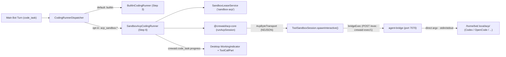

# Implementation Plan — D-241 Step 6: Opt-In Sandbox ACP Harnesses

**Status:** Planned (deferred for later implementation)
**Governing decision:** [`docs/DECISIONS.md`](../DECISIONS.md) — **D-241 Step 6**
**Preserves:** PRD §2.2 R1, R5; PRD §2.5; WORKSPACE §17, §19; D-208; D-241 Steps 1–5; D-242

---

## 1. Goal & Why Later

D-241 Steps 1–5 are complete:
- **Steps 1–3** give every Crewaid bot coding-grade file tools (`fs_read` ranges, `fs_edit`, `fs_grep`, `fs_glob`), managed background processes (`process_start`/`output`/`stop`), coding-aware compaction (`crewaid-v2`), and the orchestrator-side `code_task` Pi-style sub-loop (`BuiltInCodingRunner`) behind the SDK-independent `CodingRunner` port.
- **Step 4** added Anthropic Console monthly API credit guidance and stateless OpenAI Responses API compatibility (`store: false`, `QUOTA_EXCEEDED` mapping).
- **Step 5 (+ D-242)** delivered `@crewaid/acp-core` (single `@agentclientprotocol/sdk` seam), the `crewaid-connect` local connector CLI + built-in Electron desktop connector manager, `alwaysAsk` approval binding, and `local_code_task`.

**Step 6** brings external ACP coding harnesses (starting with **Codex**, then **OpenCode**, **Antigravity**, and user-API-key **Claude Code**) **inside the bot's own sandbox container** over the exact same `@crewaid/acp-core` and `CodingRunner` port—unlocking 24/7 unattended cloud/self-hosted sandbox runs with third-party harnesses while preserving Crewaid's core security boundaries.

---

## 2. What Already Exists to Reuse

No greenfield protocol or runner infrastructure is needed:

| Layer | Existing Piece | File(s) |
| --- | --- | --- |
| ACP client & projector | `runAcpSession()`, `AcpByteTransport` (Web `ReadableStream`/`WritableStream`), `AcpSessionProjector`, `BUILTIN_ACP_HARNESSES` | [`packages/acp-core/src/index.ts`](../../packages/acp-core/src/index.ts), [`types.ts`](../../packages/acp-core/src/types.ts) |
| Single-seam guard | `d241-acp-outside-seam` ESLint rule + negative probe (`@agentclientprotocol/*` banned outside `packages/acp-core`) | [`eslint.config.mjs`](../../eslint.config.mjs), [`tools/guard-probes/d241-acp-outside-seam.probe.ts`](../../tools/guard-probes/d241-acp-outside-seam.probe.ts) |
| Bidirectional sandbox exec | `bridgeExec` (`POST /exec`, `Upgrade: crewaid-exec/1`) with full `stdin`/`stdout`/`stderr`/`kill` and direct `argv` execution — already used identically by **Docker**, **Runtime**, and **Instabox** | [`packages/sandbox-core/src/bridge-exec.ts`](../../packages/sandbox-core/src/bridge-exec.ts), [`infra/sandbox-image/agent-bridge/exec_stream.py`](../../infra/sandbox-image/agent-bridge/exec_stream.py) |
| Sandbox runtime | Node `22.23.2` + `npm` + `git` + `ripgrep` + `fd` + `dbus-x11`, durable `/home/bot` volume | [`infra/sandbox-image/Dockerfile`](../../infra/sandbox-image/Dockerfile) |
| Runner port & persistence | `CodingRunner` (`CodingRunnerKind` already includes `'acp_sandbox'`), `CodingRun` model (already has `runnerKind`, `runnerId`, `acpSessionId`), `CodingRunStoreService` | [`apps/orchestrator/src/agent/coding/coding-runner.port.ts`](../../apps/orchestrator/src/agent/coding/coding-runner.port.ts), [`coding-run-store.service.ts`](../../apps/orchestrator/src/agent/coding/coding-run-store.service.ts) |
| Live progress UI | `crewaid.code_task.progress` AG-UI custom events rendered in `WorkingIndicator` and `ToolCallPart` | [`apps/orchestrator/src/agent/code-task-tool.ts`](../../apps/orchestrator/src/agent/code-task-tool.ts), [`apps/desktop/src/renderer/chat/codingProgress.ts`](../../apps/desktop/src/renderer/chat/codingProgress.ts) |
| Keep-running leases | `SandboxLeaseService` (`KeepRunningLease`, monotonic `keepRunningUntil`) | [`apps/orchestrator/src/sandbox/sandbox-lease.service.ts`](../../apps/orchestrator/src/sandbox/sandbox-lease.service.ts) |

---

## 3. Non-Negotiable Architecture & Security Boundaries

1. **No new sandbox ports.** Every ACP session speaks NDJSON over existing `bridgeExec` (`POST /exec` on port `7070` with `Upgrade: crewaid-exec/1`). This works identically across Docker, Runtime, and Instabox without changing provider port maps or firewalls.
2. **No Settings storage or injection of third-party harness tokens (R5).** Consistent with Chrome profiles, users sign into unmodified official CLIs directly on their bot's desktop (live RFB screen + terminal/browser). The orchestrator never stores, reads, or injects harness OAuth tokens.
3. **On-demand pinned installs into `/home/bot/.local`.** Do not bloat the base sandbox image with every CLI. Install Crewaid-tested exact versions on demand into `/home/bot/.local/acp/<harness>` (persists across restarts on the `/home/bot` volume; `/home/bot/.local` is already in `MACHINE_OWNED`).
4. **Honest black-box boundary.** Because sandboxes run with `CapDrop: ['ALL']` and `no-new-privileges`, nested `bwrap`/OS sandboxes inside CLIs (such as Codex's inner sandbox) cannot run. External sandbox harnesses therefore run with full access to `/home/bot` under the `bot` UID and bypass `PrivacyVault`, fine-grained tool approvals, orchestrator token metering, and per-step checkpoints. The real security boundary is the **per-user container** plus **D-208's server-gated GitHub push/PR approval** (GitHub tokens never enter the sandbox). The UI must state this plainly at opt-in time.
5. **Harness rollout order:**
   1. **Codex** (`@agentclientprotocol/codex-acp`, pinned exact version) — device-code login (`codex login --device-auth`) and sanctioned third-party plan use.
   2. **OpenCode** (`opencode acp`) — user-configured provider credentials inside the container.
   3. **Antigravity** (`agy acp`) — **gated on a pre-implementation verification spike** confirming login persistence inside `crewaid/sandbox:dev`, which ships `dbus-x11` without `gnome-keyring`.
   4. **Claude Code** (`@agentclientprotocol/claude-agent-acp`) — user-managed API keys configured inside the sandbox only, until Anthropic's third-party subscription rules settle.
6. **Confused-bot file-tool guardrail.** Add CLI auth/state directories (`.codex`, `.claude`, `.opencode`, `.antigravity`) to `MACHINE_OWNED` in [`workspace-paths.ts`](../../apps/orchestrator/src/agent/workspace-paths.ts) (alongside `.chrome`, `.seats`, `.config`, `.cache`, `.local`).
7. **Keep-running lease & restart settlement.** Every active sandbox ACP session holds and renews a `'sandbox-acp'` `KeepRunningLease` (WORKSPACE §17) and settles cleanly if the orchestrator restarts (`status = 'interrupted'`, preserving `CodingRun.acpSessionId`).

---

## 4. Architecture Overview



---

## 5. Phased Implementation Plan (3 Focused PRs)

### PR 6A — Interactive `bridgeExec` Seam, `MACHINE_OWNED` Guardrails & Sandbox Harness Manager

#### 1. Expose interactive stdio on `ToolSandboxSession` (`packages/sandbox-core`)
- **`packages/sandbox-core/src/types.ts`:**
  - Add narrow optional `spawnInteractive?: SandboxInteractiveSpawn` on `ToolSandboxSession` (following the exact existing pattern of `readonly git?: GitProcessRunner` and `readonly readTextFileRange?: SandboxReadTextRange`):
    ```ts
    export interface SandboxInteractiveSpawnOptions {
      readonly argv: readonly string[];
      readonly workingDirectory?: string | undefined;
      readonly env?: Readonly<Record<string, string>> | undefined;
      readonly abortSignal?: AbortSignal | undefined;
    }

    export interface SandboxInteractiveProcess {
      readonly stdin: WritableStream<Uint8Array>;
      readonly stdout: ReadableStream<Uint8Array>;
      readonly stderr: ReadableStream<Uint8Array>;
      wait(): Promise<{ exitCode: number }>;
      kill(): Promise<void>;
    }

    export type SandboxInteractiveSpawn = (
      options: SandboxInteractiveSpawnOptions,
    ) => Promise<SandboxInteractiveProcess>;
    ```
- **`packages/sandbox-core/src/sandbox-session.ts`:**
  - Implement `spawnInteractive` on `ContainerSandboxSession` and forward it through `restricted()`.
  - Calls `this.#container.spawn({ command: options.argv, stdin: true, workingDirectory, env })` directly (no `sh -c`), wires `options.abortSignal` → `process.kill()`, and asserts `process.stdin !== null`.
  - **Zero changes needed in `sandbox-docker`, `sandbox-runtime`, or `sandbox-instabox`**: all three already route `SandboxContainer.spawn` directly through `bridgeExec`.
- **`packages/sandbox-core/src/sandbox-session.test.ts`:**
  - Add unit tests proving `spawnInteractive` passes exact `argv` with `stdin: true`, streams bidirectional bytes, forwards `abortSignal` to `kill()`, and stays isolated from `SANDBOX_INFRA_SURFACE`.

#### 2. Extend `@crewaid/acp-core` transport & session resume helpers (`packages/acp-core`)
- **`packages/acp-core/src/client.ts` & `types.ts`:**
  - Verify `runAcpSession()` works cleanly against any `AcpByteTransport` whose `writable`/`readable` are Web streams backed by `bridgeExec` (backpressure, mid-stream disconnect, `stderr` capture, `cancelGraceMs` → `close()`).
  - Add optional `resumeAcpSessionId?: string` on `AcpRunInput` (attempting ACP `session/load` when the agent advertises `loadSession`, falling back cleanly to `session/new` or surfacing an explicit error as requested).
- **`packages/acp-core/src/acp-client.test.ts`:**
  - Add a test exercising `runAcpSession` over a Web-stream `AcpByteTransport` (simulating `bridgeExec` framing + mid-run disconnect + `AbortSignal` cancel).

#### 3. Protect CLI auth directories from confused file tools (`apps/orchestrator`)
- **`apps/orchestrator/src/agent/workspace-paths.ts`:**
  - Add `.codex`, `.claude`, `.opencode`, `.antigravity` to `MACHINE_OWNED`.
- **`apps/orchestrator/test/workspace-paths.test.ts`:**
  - Assert `resolveWorkspacePath` and `resolveWorkspaceSearchPlan` refuse/exclude these directories for `fs_read`, `fs_edit`, `fs_write`, `fs_grep`, and `fs_glob`.

#### 4. On-demand sandbox harness catalog & installer (`apps/orchestrator`)
- **`apps/orchestrator/src/sandbox/sandbox-harness-catalog.ts` (new):**
  - Pinned, Crewaid-tested install manifest per harness (exact package versions / SHA-256 verified install scripts, binary paths under `/home/bot/.local/acp/<harness>`, login command argv, non-secret auth-file presence checks):
    - `codex`: `npm install --prefix /home/bot/.local/acp/codex --save-exact @agentclientprotocol/codex-acp@<pinned>` (plus pinned `@openai/codex` if separate login CLI is needed).
    - `opencode`: pinned release install into `/home/bot/.local/acp/opencode`.
    - `antigravity`: gated behind a feature flag / enabled only after the keyring persistence spike below passes.
    - `claude-code`: `npm install --prefix /home/bot/.local/acp/claude-code --save-exact @agentclientprotocol/claude-agent-acp@<pinned>` (API-key-only guidance in UI).
- **`apps/orchestrator/src/sandbox/sandbox-harness.service.ts` (new):**
  - Strictly user-scoped (`userId`, audited in `prisma-allowlist.test.ts`):
    - `list(userId, botId)`: checks installed binaries, versions, and presence (boolean only — never reads or returns token contents!) of expected auth config files on that bot's computer.
    - `install(userId, botId, harnessId)`: acquires a `'sandbox-acp'` `KeepRunningLease`, runs the pinned install command into `/home/bot/.local/acp/<harness>`, verifies `--version` / binary executability, releases lease.
    - `uninstall(userId, botId, harnessId)`: removes `/home/bot/.local/acp/<harness>` (optionally clears auth directory only when explicitly requested).
    - `openLoginTerminal(userId, botId, harnessId)`: launches `xfce4-terminal` on the bot's live display (`DISPLAY` of the bot's seat / machine) running the CLI's official interactive login command so the operator authenticates directly on the bot's screen.
- **Pre-implementation verification spike for Antigravity (`agy`):**
  - Run `agy` inside a `crewaid/sandbox:dev` container (`CapDrop: ['ALL']`, `no-new-privileges`, `dbus-x11` without `gnome-keyring`), authenticate, stop and restart the container, and verify whether credentials survive across restarts. Document the result in `DECISIONS.md` before exposing `antigravity` in the sandbox catalog.

---

### PR 6B — `SandboxAcpCodingRunner`, Bot Runner Config, Leases & Crash Recovery

#### 1. Shared schemas & Prisma migration (`packages/shared`, `apps/orchestrator`)
- **`packages/shared`:**
  - Define `SandboxCodingHarnessIdSchema = z.enum(['codex', 'opencode', 'antigravity', 'claude-code'])` and `BotCodingRunnerSchema = z.enum(['builtin', 'acp_sandbox:codex', 'acp_sandbox:opencode', 'acp_sandbox:antigravity', 'acp_sandbox:claude-code'])` (with valid/invalid fixture pairs in `packages/shared/src/schemas.test.ts`).
  - Expose `codingRunner` on `BotSchema`, `CreateBotBodySchema`, `UpdateBotBodySchema`, and `SandboxHarnessStatusSchema` for the computer harness status endpoints.
  - Require an explicit `acknowledgeSandboxHarnessBoundary: true` boolean on `PATCH /bots/:id` when switching a bot from `'builtin'` to an `'acp_sandbox:*'` runner (auditability of opt-in).
- **`apps/orchestrator/prisma/schema.prisma` + additive migration:**
  - Add `codingRunner String @default("builtin")` on `Bot` (nullable/default `'builtin'`, additive — zero breaking changes to existing rows).
  - Verify `CodingRun` already has `runnerKind`, `runnerId`, `acpSessionId`, `status`, `filesChanged`, `errorCode` (no extra columns needed unless adding `harnessVersion String?`).
  - Update `test/schema-contract.test.ts` and `test/prisma-allowlist.test.ts`.

#### 2. Keep-running lease owner (`apps/orchestrator`)
- **`apps/orchestrator/src/sandbox/sandbox-lease.service.ts`:**
  - Add `'sandbox-acp'` to `ComputerOwner`.

#### 3. `SandboxAcpCodingRunner` (`apps/orchestrator`)
- **`apps/orchestrator/src/agent/coding/sandbox-acp-coding-runner.ts` (new):**
  - Implements `CodingRunner` (`kind: 'acp_sandbox'`, `id: 'acp:sandbox:<harness>'`).
  - Imports ONLY `@crewaid/acp-core` (never `@agentclientprotocol/sdk`).
  - Execution flow:
    1. Resolve pinned binary under `/home/bot/.local/acp/<harness>`; if missing, return structured `failed` result (`HARNESS_NOT_INSTALLED`) instructing the user to install it on the bot's computer.
    2. Acquire `'sandbox-acp'` `KeepRunningLease` from `SandboxLeaseService`.
    3. Snapshot initial `git status --porcelain` in `task.cwd` (same helper as `BuiltInCodingRunner`).
    4. Spawn harness via `session.spawnInteractive({ argv, workingDirectory: task.cwd, env, abortSignal })` — ensuring `PATH` includes `/home/bot/.local/acp/<harness>/node_modules/.bin:/home/bot/.local/bin:/usr/local/bin:/usr/bin:/bin`, and **never** passing any orchestrator secrets or API keys.
    5. Construct `AcpByteTransport` over `{ readable: proc.stdout, writable: proc.stdin, close: () => proc.kill() }`.
    6. Call `runAcpSession()` with:
       - `reportMode: 'full'` (files already live on Crewaid's sandbox, unlike private laptop repos in Step 5).
       - `onProgress`: renew the `'sandbox-acp'` lease on progress, persist `acpSessionId` onto the `CodingRun` row immediately on `'started'`, and translate `AcpProgressUpdate` into `CodingProgressEvent` (reusing `crewaid.code_task.progress`).
       - `onPermissionRequest`: follow the agreed sandbox permission policy (see §6 Open Decisions).
       - Timeout combining `invocation.abortSignal` and `AbortSignal.timeout(invocation.maxDurationMs)`.
    7. Snapshot post-run `git status --porcelain` and merge with ACP-reported `filesChanged`.
    8. Settle `CodingRun` (`status`, `steps`, `workingMs`, `filesChanged`, `acpSessionId`, `errorCode`) and release the `'sandbox-acp'` lease in `finally`.

#### 4. Runner dispatch & recovery (`apps/orchestrator`)
- **`apps/orchestrator/src/agent/coding/coding-runner-dispatcher.ts` (new):**
  - Bound to `CODING_RUNNER` DI token; inspects the bot's configured `codingRunner` (threaded via `ToolContext` / `CodingInvocation`) and dispatches to `BuiltInCodingRunner` (`'builtin'`) or `SandboxAcpCodingRunner` (`'acp_sandbox:*'`).
  - `code_task` (`code-task-tool.ts`) stays a single tool for the main bot — the bot doesn't need to know which sandbox runner is configured, and its Crewaid tools (browser, screen recording, Work board, GitHub PR publication) remain unchanged.
- **`apps/orchestrator/src/agent/coding/coding-run-store.service.ts` & `run-recovery.service.ts`:**
  - Add `recordAcpSessionId(userId, botId, runId, acpSessionId)` so `CodingRun.acpSessionId` is durable before the run finishes.
  - In `reconcileAbandonedForRun`: settle abandoned `acp_sandbox` runs as `status = 'interrupted'`, `errorCode = 'WORKER_LOST'` (preserving `acpSessionId`), so the operator and bot see clearly that the sandbox harness session was interrupted by a server restart rather than silently dropped.

---

### PR 6C — Owner-Scoped REST Routes, Desktop Settings & Bot Profile UI

#### 1. Orchestrator REST controller (`apps/orchestrator`)
- **`apps/orchestrator/src/sandbox/sandbox-harnesses.controller.ts` (new):**
  - Guarded with `@OwnedResource` + `ResourceOwnershipGuard` (verified by `test/ownership-route-coverage.test.ts`):
    - `GET /bots/:id/computer/harnesses`
    - `POST /bots/:id/computer/harnesses/:harnessId/install`
    - `DELETE /bots/:id/computer/harnesses/:harnessId`
    - `POST /bots/:id/computer/harnesses/:harnessId/login`
  - Every route uses Zod schemas from `@crewaid/shared`.

#### 2. Desktop UI (`apps/desktop`)
- **API client (`apps/desktop/src/renderer/api/`):** Typed client calls validated with shared schemas.
- **Bot Profile (`BotCodingRunnerField.tsx` alongside `BotCodingModelField.tsx`):**
  - Picker for **Coding engine**: **Built-in (Crewaid)** (default — shows the existing Coding model picker) vs installed **Sandbox harnesses** (e.g. **Codex (on bot's computer)**, **OpenCode (on bot's computer)**).
  - When selecting a sandbox harness, display an explicit disclosure banner explaining:
    - Runs directly inside this bot's computer with full access to `/home/bot` (shared across bots on the same computer).
    - Bypasses Crewaid's `PrivacyVault`, per-tool approvals, token metering, and per-step checkpoints.
    - GitHub push and PR creation remain approval-gated by Crewaid (D-208).
- **Computer / Sandbox Harnesses management section** (accessible from the computer settings / bot profile):
  - Lists supported sandbox harnesses with `Not installed`, `Installing…`, `Installed (sign in on screen)`, or `Ready` badges.
  - Actions: **Install**, **Sign in on bot's screen** (triggers `openLoginTerminal` and opens the bot's live screen pane), **Remove**.
- **i18n (`apps/desktop/src/renderer/i18n/messages/en/`):**
  - Add all new user-facing copy in English message modules (zero literal English strings in renderer JSX); run `pnpm i18n:translate` before release.

---

## 6. Open Design Decisions to Confirm Before Starting PR 6A

1. **ACP `session/request_permission` inside the sandbox:**
   - **Recommended:** Auto-select `allow_once` inside opted-in sandbox harnesses (unlike host local connectors, which always fail closed and ask on the user's machine). Rationale: D-241 Step 6 explicitly treats sandbox harnesses as an honest black-box boundary inside the per-user container (with D-208 gating GitHub push/PR), and auto-allowing in-container actions is required for 24/7 unattended routines.
   - **Alternative:** Pause and surface an approval prompt in Crewaid chat (blocks unattended routines and would require bridging ACP permission prompts across turns).
2. **Computer-wide vs. per-bot install & login UX:**
   - Because all bots for a user share one computer (`/home/bot`, WORKSPACE §19), installing `/home/bot/.local/acp/codex` and signing into `/home/bot/.codex` once makes Codex ready for every bot on that computer. Confirm whether the management UI should live under **Settings → Computer** (matching the actual machine-wide scope) with a link from each Bot's profile.
3. **Antigravity (`agy`) login persistence spike:**
   - Run the `crewaid/sandbox:dev` container spike (`dbus-x11`, no `gnome-keyring`, container restart) before adding `antigravity` to the sandbox harness list. If `agy` requires a keyring daemon or drops tokens on restart, keep it behind a flag until upstream supports headless file-backed persistence.
4. **ACP `session/load` resume after orchestrator restart:**
   - **Recommended:** In PR 6B, persist `CodingRun.acpSessionId` on start and cleanly mark abandoned runs `interrupted` (`WORKER_LOST`) on restart; add automatic `session/load` resumption as a follow-up once `codex-acp` and `opencode acp` prove stable `session/load` behavior across process restarts.

---

## 7. Verification Plan (When Implemented)

```bash
# PR 6A
pnpm --filter @crewaid/sandbox-core test
pnpm --filter @crewaid/acp-core test
pnpm --filter @crewaid/orchestrator exec vitest run \
  test/workspace-paths.test.ts \
  test/sandbox-harness.service.test.ts

# PR 6B
pnpm --filter @crewaid/shared test
pnpm --filter @crewaid/orchestrator exec vitest run --no-file-parallelism \
  test/sandbox-acp-coding-runner.test.ts \
  test/code-task-tool.test.ts \
  test/schema-contract.test.ts \
  test/prisma-allowlist.test.ts

# PR 6C
pnpm --filter @crewaid/orchestrator exec vitest run \
  test/ownership-route-coverage.test.ts \
  test/sandbox-harnesses.controller.test.ts
pnpm --filter @crewaid/desktop test
pnpm --filter @crewaid/desktop security:probe

# Full gate on every PR
pnpm build && pnpm lint && pnpm typecheck
node tools/guard-probes/run-probes.mjs
node scripts/check-pins.mjs
```

### Live Smoke Verification (Before Shipping)
1. **Docker, Runtime, and Instabox parity:** Install `codex-acp` on-demand into `/home/bot/.local`, run a multi-file `code_task`, verify live progress events in desktop chat, and verify `CodingRun` records `runnerKind = 'acp_sandbox'`, `acpSessionId`, and `filesChanged`.
2. **Auth persistence:** Sign into Codex via `openLoginTerminal` on the live RFB desktop, stop and restart the computer, and confirm Codex remains authenticated without re-login.
3. **Boundary & cancellation:** Verify `fs_read` / `fs_grep` refuse `/home/bot/.codex`; verify clicking **Stop** mid-task sends ACP `session/cancel`, kills the child process over `bridgeExec`, and releases the `'sandbox-acp'` `KeepRunningLease`.
4. **Crash recovery:** Kill the orchestrator mid-run, restart it, and verify the abandoned `CodingRun` settles cleanly as `interrupted` (`WORKER_LOST`) with its `acpSessionId` preserved.
