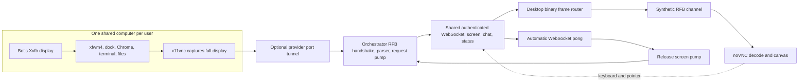
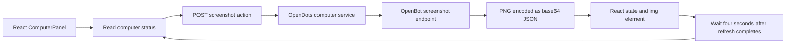
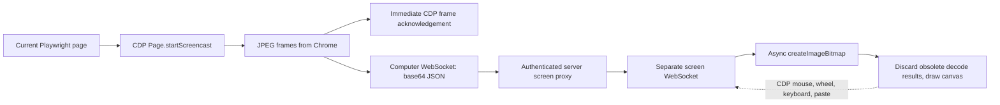

# Bot screen streaming: Crewaid, OpenDots, and OpenBot

Research snapshot: the review below records the analysis before board changes. The subsequent implementation plan is [the D-158 modernization handoff](../plans/ARCHITECTURE-MODERNIZATION-2026-10-03.md); no product migration is implemented by this report. The user subsequently confirmed there are no launched users or production data; D-158 now omits historical data/client compatibility and deployment rollback work.

Reviewed on 2026-10-03. This extends the [architecture review](OPENDOTS-ARCHITECTURE-REVIEW-2026-10-03.md) and [TanStack AI comparison](TANSTACK-AI-VS-AI-SDK-2026-10-03.md).

**Recommendation: keep the shared computer and separate bot desktops. Fix or replace the screen delivery layer.** The strongest source-level explanation for the reported lag is our stop-and-wait delivery policy: every screen update waits for the remote viewer's WebSocket pong before the next update is requested. This makes a distant connection feel choppy even when bandwidth is adequate. It is a well-intentioned backlog protection with an expensive latency tradeoff.

OpenDots itself is not a superior live desktop reference: its panel polls PNG screenshots every four seconds. Its pinned OpenBot dependency has a more interesting browser-only CDP screencast. Borrow its lifecycle and rendering ideas selectively. For the full desktop we need, evaluate **KasmVNC 1.5.0 first**, with **Selkies 2.0.0 as the alternative that can attach to our existing displays**. Both can preserve one computer per user and one display per bot; neither requires a computer or container per bot.

## Scope and evidence

The user identified the problem as **the expanded screen during manual control on the hosted/remote server**. That makes steady-state frame pacing, network topology, input-to-picture delay, and decode time more relevant than thumbnail styling or image build time.

Source revisions:

| Project | Reviewed revision |
| --- | --- |
| Crewaid | `8e77f0d0994661e5a32092aa28904a50374c7313` |
| OpenDots | `c2569bb6a13a22e565cf3eb791c62267d06babb1` |
| OpenBot, as pinned by OpenDots | `b6932d31a8d6e7896c15139dfc27a6c6911deb27` |

**Evidence levels:** the stream topology, pacing policy, image contents, and client behavior below are verified in source. Their contribution to the actual hosted lag remains a hypothesis until measured on that deployment. The local Docker daemon was unavailable; no live hosted frame-rate, bandwidth, CPU, browser-decoding, or packet-loss measurements were obtained. Published dependency capabilities are documented upstream, not benchmarked in Crewaid.

The task board marks the sandbox image, screen viewer, input forwarding, and shared-computer work done. This is an improvement review of shipped behavior. Application code, dependency manifests, `tasks.json`, and generated board files were not changed.

## 1. Three different pipelines

### Crewaid: full desktop, shared RFB source



The actual current seat starts its own Xvfb display, session bus, window manager, wallpaper, dock, and x11vnc. Chrome starts lazily with the seat's profile. Some comments still describe the earlier window-scoped seats; the executable code now captures the entire bot display. The base machine also runs its own desktop, but bot subscriptions resolve their seat's RFB port. [Seat launch](../../infra/sandbox-image/agent-bridge/seats.py#L656), [seat resolution](../../apps/orchestrator/src/screen/screen.service.ts#L335).

The orchestrator requests Tight, CopyRect, Raw, and cursor shapes, scans complete RFB server messages without decoding pixels, and relays binary bytes. The client synthesizes the RFB handshake for noVNC and swallows noVNC's update requests because the server owns the pump. This is more custom protocol machinery than a standard viewer connection. [Encoding negotiation](../../apps/orchestrator/src/screen/rfb-protocol.ts#L421), [upstream pump](../../apps/orchestrator/src/screen/rfb-upstream.ts#L380), [client adapter](../../apps/desktop/src/renderer/screen/rfbChannel.ts#L1).

### OpenDots: screenshot polling



The panel refreshes after explicit actions, and pauses periodic refresh while hidden or busy. Its ordinary automatic cadence is **four seconds plus refresh duration**, not interactive video. This is suitable for inspection; it is not evidence of smoother scrolling or typing. OpenDots' browser controls and full desktop takeover are different products. [Panel refresh and polling](https://github.com/CopilotKit/OpenDots/blob/c2569bb6a13a22e565cf3eb791c62267d06babb1/src/client/ComputerPanel.tsx#L40), [image rendering](https://github.com/CopilotKit/OpenDots/blob/c2569bb6a13a22e565cf3eb791c62267d06babb1/src/client/ComputerPanel.tsx#L305), [action forwarding](https://github.com/CopilotKit/OpenDots/blob/c2569bb6a13a22e565cf3eb791c62267d06babb1/src/server/computer-service.ts#L316).

### OpenBot: live Chrome page stream



The cast defaults to JPEG quality 70 and a maximum 1280×800. A one-second follow loop switches the cast when the current page changes; it does not limit the frame cadence to one FPS. It streams page content, excluding browser chrome, desktop applications, and OS dialogs. [Capture](https://github.com/CopilotKit/OpenBot/blob/b6932d31a8d6e7896c15139dfc27a6c6911deb27/agent-computer/src/screencast.ts#L141), [page following](https://github.com/CopilotKit/OpenBot/blob/b6932d31a8d6e7896c15139dfc27a6c6911deb27/agent-computer/src/index.ts#L477), [client](https://github.com/CopilotKit/OpenBot/blob/b6932d31a8d6e7896c15139dfc27a6c6911deb27/app/src/components/computer/live-screen.tsx#L99).

CDP screencasting is an experimental Chrome protocol facility, not a general desktop video transport. It can also be attached to a headed Chrome page, so an optional browser-only view would not require removing our bot's display or changing profile storage. [Chrome protocol](https://chromedevtools.github.io/devtools-protocol/tot/Page/#method-startScreencast).

## 2. Most likely bottleneck: one update per round trip

In `ScreenStream.awaitDelivery`, the server sends a ping to each attached viewer, pauses the upstream, and resumes only after all corresponding pongs arrive. The pause executes before `RfbUpstream` can schedule its next framebuffer request. This is deliberate and covered by existing integration-test expectations. [Delivery hold](../../apps/orchestrator/src/screen/screen.service.ts#L719), [release](../../apps/orchestrator/src/screen/screen.service.ts#L785), [test expectations](../../apps/orchestrator/test/screen-multiplex.integration.test.ts#L569).

For a continuously changing screen, an approximate upper bound is:

`updates/second ≤ 1000 / (viewer delivery round trip + upstream request/capture/transfer time)`

Even if the upstream and image transfer were free:

| Viewer round trip | Theoretical upper bound |
| --- | ---: |
| 40 ms | 25 updates/s |
| 100 ms | 10 updates/s |
| 200 ms | 5 updates/s |
| 400 ms | 2.5 updates/s |
| 700 ms | 1.4 updates/s |

These are explanatory calculations, **not measured results for the user's server**. An RFB update also need not correspond exactly to one displayed animation frame. Nevertheless, the policy puts a real cadence ceiling on a busy screen.

The protection has value: x11vnc can fold intervening desktop changes into the next requested update instead of filling network queues with stale pictures. Removing the wait and pumping without bounds would reintroduce the backlog the code was written to prevent.

**Improve the control policy, not merely the JPEG setting.** If retaining RFB, evaluate a bounded delivery window with both byte and update limits, informed by receiver progress and an agreed frame-age budget. Keep the upstream request pump bounded separately. A small fixed window is not automatically sufficient: 30 updates/s over a 200 ms feedback loop requires roughly six updates of concurrency even before encoding and transfer. The policy must balance smoothness against backlog, memory, and readability.

Preserve every required RFB delta in order. Tight compression dictionaries and CopyRect depend on history. Arbitrarily dropping RFB messages or applying OpenBot's full-image replacement rule to this stream corrupts the viewer. A viewer that falls outside the allowed budget needs a controlled resynchronization, a separate source, or disconnection with a fresh decoder.

A plain switch to a standard noVNC socket is also not automatically a pacing fix. In the installed noVNC, ordinary RFB sends the next update request after the prior one; continuous updates change that behavior only when the server supports them. Evaluate actual server/protocol support. [Installed receive loop](https://unpkg.com/@novnc/novnc@1.7.0/core/rfb.js).

### Another feedback loop on hosted sandbox providers

Docker-hosted screens can have a short sandbox-to-orchestrator hop. Cloudflare and DigitalOcean provider implementations instead expose remote TCP ports through an in-process loopback-to-WebSocket tunnel. Consequently, an endpoint showing `127.0.0.1` does not prove that capture is local. The RFB request-response loop can traverse another remote round trip. Determine the deployed provider and measure both hops. [Shared tunnel implementation](../../packages/sandbox-core/src/port-tunnel.ts#L1), [Cloudflare attachment](../../packages/sandbox-cloudflare/src/cf-sandbox-provider.ts#L422), [DigitalOcean attachment](../../packages/sandbox-digitalocean/src/do-sandbox-provider.ts#L716).

Putting capture pacing close to the display and streaming encoded output avoids a WAN request for each captured update. That is useful regardless of whether the eventual component uses WebSocket video or WebRTC.

## 3. Other verified costs and limitations

| Finding | Consequence | Recommendation |
| --- | --- | --- |
| Shared stream waits for its slowest viewer | A second distant or congested viewer slows an otherwise healthy operator | Give the active controller an independent delivery budget; isolate observers where needed |
| Late subscriber replaces the upstream and resets all decoders | Existing viewers can briefly pause whenever someone joins | Prefer a mature server's independent client state, or explicitly manage separate RFB upstreams |
| Expanded view requests quality 9; compression level is fixed at 6 | High image quality and compression can increase bytes or encode work | Compare readable lower quality and compression levels against actual network and CPU data |
| Quality drops only after judged transfer EMA exceeds 350 ms | Adaptation tolerates delays far beyond a smooth interaction budget | Tune to an explicit interaction target after changing the cadence policy |
| `-noxdamage` on every seat's x11vnc | Reliable repainting, but polling/capture work scales with active displays | Profile capture first; do not blindly remove the correctness workaround |
| No explicit compositor-disable setting in seat launch | Compositing may add software work under Xvfb | Measure and compare disabling compositor/dock animations; source does not prove their current cost |
| Chrome uses `--disable-dev-shm-usage` despite a 512 MiB shared-memory mount | Chrome can use temporary-file backing instead of the intended shared-memory path | Benchmark with sufficient shared memory and concurrent browsers before changing the flag |
| Screen bytes share the chat/status socket | Large outbound images can delay subsequent outbound text/status and couple reconnects | Separate screen delivery from conversation events |

Sources: [viewer membership and upstream replacement](../../apps/orchestrator/src/screen/screen.service.ts#L434), [quality requests](../../apps/desktop/src/renderer/screen/screenCardState.ts#L56), [quality controller](../../apps/orchestrator/src/screen/screen-quality.ts#L44), [capture launch](../../infra/sandbox-image/agent-bridge/seats.py#L745), [Chrome launch](../../infra/sandbox-image/agent-bridge/seats.py#L840), [Docker resource settings](../../packages/sandbox-docker/src/docker-sandbox-provider.ts#L1226).

The socket is full duplex: outbound image bytes do not automatically sit ahead of inbound mouse bytes. The clearest coupling is outbound chat/status ordering, shared processing, and the fact that a screen overflow terminates the connection that also carries conversation events. Separate sockets alone do not solve capture or round-trip gating.

The current four-CPU, 8 GiB, 2048-task computer limits are caps, not reserved host capacity. Six busy browsers can still compete with capture and encoding. Check host saturation and cgroup throttling rather than assuming the image or configured caps guarantee responsive screens. [Default limits](../../packages/sandbox-docker/src/docker-sandbox-provider.ts#L63).

### Receipt is not presentation

Automatic WebSocket pong does not prove that noVNC finished decoding and painting an update. The client delivers bytes through a microtask queue; noVNC has its own ordered render queue. There is no application render-completion acknowledgement in the current screen path. This means our adaptation sees transport feedback, not the complete user-visible delay. [Client delivery](../../apps/desktop/src/renderer/screen/rfbChannel.ts#L304), [installed render queue](https://unpkg.com/@novnc/novnc@1.7.0/core/display.js).

Pixels already bypass the chat reducer and per-frame Zod parsing. The viewer keeps one noVNC canvas when expanding or collapsing. React calls `setHasPicture(true)` after picture updates, but repeated identical values do not imply a React commit for every frame. A frontend rewrite should be justified by renderer profiling, not by assuming React renders the pixels. [Binary router](../../apps/desktop/src/renderer/connection/wsClient.ts#L356), [viewer](../../apps/desktop/src/renderer/screen/ScreenCard.tsx#L351).

## 4. What to borrow from OpenBot—and where it needs improvement

Borrow these principles:

- Dedicated screen transport and browser-native capture for an optional page-only view.
- Async bitmap decoding, obsolete-result guards, bitmap cleanup, and visibility-aware rendering.
- Explicit viewer ownership, reconnect checks, and teardown of a cast that finishes opening after its socket has disappeared.
- Server-enforced human input permission. Stream subscription and ownership of a canvas are not permission to drive a bot.
- A stream follows the current browser page without rebuilding the whole computer.

Their implementation is not a finished end-to-end congestion solution. Chrome frames are acknowledged immediately, before remote delivery. The computer's callback calls `ws.send` without checking its result. The server proxy likewise calls `ws.send` without handling backpressure or a drain event. Although its comment says slow frames should be dropped, that policy is not implemented there. Bun documents `-1` as **queued with backpressure**, not successful unbuffered delivery. Therefore immediate CDP acknowledgement does not prevent remote queues from growing. [Computer send](https://github.com/CopilotKit/OpenBot/blob/b6932d31a8d6e7896c15139dfc27a6c6911deb27/agent-computer/src/index.ts#L477), [server relay](https://github.com/CopilotKit/OpenBot/blob/b6932d31a8d6e7896c15139dfc27a6c6911deb27/server/src/index.ts#L1472), [Bun backpressure semantics](https://bun.sh/docs/runtime/http/websockets).

The frontend discards an older decoded bitmap when a newer frame has arrived, but begins decoding every visible incoming frame. That prevents stale presentation; it does not cap simultaneous decode work or bytes already received. A better JPEG implementation would keep one decode underway and one latest pending independent image, with bounded queues at every relay. Its JSON/base64 frames also expand JPEG payloads by roughly a third before transport compression. Our binary RFB relay is already better on that particular overhead. [Decode and message handlers](https://github.com/CopilotKit/OpenBot/blob/b6932d31a8d6e7896c15139dfc27a6c6911deb27/app/src/components/computer/live-screen.tsx#L99).

Do not copy the claim that the existing noVNC image path is entirely synchronous: the installed noVNC waits for image load and maintains ordering. Async bitmap APIs are useful, but the gain must be measured. More importantly, a complete JPEG frame can safely supersede an older complete image; a compressed RFB delta cannot.

OpenBot gives one live viewer the slot and supersedes another. Crewaid currently supports multiple viewers. Borrow ownership fencing for **control** without accidentally removing legitimate observers. [Viewer slot](https://github.com/CopilotKit/OpenBot/blob/b6932d31a8d6e7896c15139dfc27a6c6911deb27/agent-computer/src/viewer.ts), [input authorization](https://github.com/CopilotKit/OpenBot/blob/b6932d31a8d6e7896c15139dfc27a6c6911deb27/agent-computer/src/index.ts#L565).

## 5. Docker image comparison

OpenDots builds the pinned OpenBot `agent-computer/Dockerfile`. The template chooses headless browser mode and one computer container per Dot. Its live stream belongs to OpenBot's separate app; the OpenDots panel described above does not use that socket. [Compose definition](https://github.com/CopilotKit/OpenDots/blob/c2569bb6a13a22e565cf3eb791c62267d06babb1/compose.computers.yml).

| Area | Crewaid | Pinned OpenBot computer |
| --- | --- | --- |
| Base | Debian Bookworm slim; Node 22 toolchain | Ubuntu 24.04; Node 24 and Bun 1.3.14 toolchains |
| Browser install | Google Chrome stable through apt | Playwright 1.62.1 and its matching Chromium install |
| Screen components | Xvfb, window manager/desktop, dock, x11vnc; noVNC in client | Chrome CDP cast; headed mode can start Xvfb |
| Scope of image | General computer tools, recording, accessibility, desktop applications | Primarily browser, shell, files, computer HTTP/WS service |
| Runtime user | Explicit `USER bot` | Dockerfile has no `USER`; reviewed supervisor does not override `User` |
| Chrome sandbox | Runtime probe; enabled where permitted, disclosed fallback | Managed-browser default disabled unless explicitly enabled |
| Browser lifecycle | Per-seat lazy browser and durable identity directory | Per-bot persistent browser context/profile |

Sources: [our image](../../infra/sandbox-image/Dockerfile#L40), [OpenBot image](https://github.com/CopilotKit/OpenBot/blob/b6932d31a8d6e7896c15139dfc27a6c6911deb27/agent-computer/Dockerfile), [supervisor container creation](https://github.com/CopilotKit/OpenBot/blob/b6932d31a8d6e7896c15139dfc27a6c6911deb27/supervisor/src/docker.ts#L522), [browser policy](https://github.com/CopilotKit/OpenBot/blob/b6932d31a8d6e7896c15139dfc27a6c6911deb27/agent-computer/src/profiles.ts#L75).

Their smaller desktop stack saves runtime work by supporting a narrower screen. Changing Debian to Ubuntu, Node to Bun, or copying the Dockerfile will not remove our delivery wait. Keep our non-root execution, browser sandbox support, lazy Chrome, and independent displays.

Useful image improvements are matching browser automation and browser versions, testing image upgrades against existing durable volumes, recording immutable image digests for performance comparisons, and examining unnecessary always-running base-desktop processes. The current base desktop remains part of readiness/health assumptions, so retiring it requires tracing those dependencies first. Pinning Node alone does not make apt-installed Chrome or the full image reproducible. These are maintenance improvements, not a diagnosis of today's lag.

## 6. Reuse an established desktop streamer

### KasmVNC 1.5.0: first candidate for replacing custom desktop transport

KasmVNC's current release supports desktop image streaming and video codecs, including software or hardware H.264. Its built-in adaptation and frame/bottleneck statistics address work we currently maintain ourselves. Start with its WebSocket path so a first comparison does not depend on opening UDP connectivity. [Release 1.5.0](https://github.com/kasmtech/KasmVNC/releases/tag/v1.5.0), [video mode](https://docs.kasmvnc.com/docs/video_streaming_mode), [statistics API](https://docs.kasmvnc.com/docs/developer_api).

The proposed topology is one KasmVNC X server per bot seat, inside the same user computer, with our browser profiles, workspaces, and session buses retained. It could replace Xvfb plus x11vnc and much of the hand-built RFB parser, shared pump, handshake shim, and quality policy. Multiple instances with distinct display numbers are supported. This is an architectural fit to validate, not an already integrated solution. [Project documentation](https://github.com/kasmtech/KasmVNC/blob/v1.5.0/README.md).

KasmVNC is **not a drop-in server for our current noVNC shim**: it changes the protocol and has its own browser client. Embedding that client, retaining fixed seat geometry, and connecting our auth and recording hooks are part of the integration. Its repository carries a GPL v2 license; inspect the specific server, client, and distributed image components before selecting how to package them. [Protocol distinction](https://github.com/kasmtech/KasmVNC/blob/v1.5.0/README.md), [license](https://github.com/kasmtech/KasmVNC/blob/v1.5.0/LICENSE.TXT).

### Selkies 2.0.0: alternative that attaches to our existing seat displays

Selkies' native installation can capture an existing X11 display, making a per-seat process alongside our current Xvfb a useful comparison. Its latest 2.0 release uses bundled Rust capture/encoding extensions, WebCodecs, WebSocket streaming by default, and optional WebRTC. It no longer requires the older GStreamer runtime architecture. [Native attachment](https://docs.selkies.io/latest/native), [2.0 release](https://github.com/selkies-project/selkies/releases/tag/2.0.0).

Use fixed-resolution settings and verify independently addressed processes for two simultaneous bot displays; disable dynamic resize and secondary-monitor behavior for our fixed geometry contract. Keep our existing viewer as fallback during the experiment. [Settings reference](https://docs.selkies.io/latest/settings).

Version 2.0 was released on September 23, shortly before this review. Its redesign and the project's request for maintainers deserve a real comparison, rather than assuming maturity from older Selkies deployments. Selkies itself is MPL 2.0; default media builds include GPL components, so inventory the actual package/image. [Release](https://github.com/selkies-project/selkies/releases/tag/2.0.0), [project](https://github.com/selkies-project/selkies), [component licenses](https://docs.selkies.io/latest/licensing).

### Choosing a path

| Approach | Full bot desktop? | Keeps shared computer? | Work retained or added | Assessment |
| --- | --- | --- | --- | --- |
| Improve current RFB pacing | Yes | Yes | Retain parser, shared stream state, shim, adaptation | Smallest initial change; still substantial ownership |
| Standard noVNC per viewer | Yes | Yes | Less multiplexer complexity; server extension and pacing work still matter | Useful baseline, not guaranteed WAN improvement |
| OpenBot-style CDP view | Browser page only | Yes | Capture/input/decode/congestion logic | Optional page view; insufficient as sole screen |
| KasmVNC per seat | Yes | Yes | Change X server/client; integrate authorization and recording | First replacement candidate |
| Selkies attached per seat | Yes | Yes | Add capture server/client; integrate authorization and recording | Strong alternative; test recent 2.0 behavior |

Do not build a custom FFmpeg/WebRTC platform merely because ffmpeg is already installed. That still leaves signaling, codec negotiation, congestion, reconnects, input, decode, and tenant access control to us. Use a maintained component if it meets the acceptance criteria.

Video over WebSocket can improve encoding and presentation without removing TCP head-of-line blocking under packet loss. WebRTC can address different network behavior but adds ICE/STUN/TURN and provider connectivity requirements. Existing provider port tunnels expose TCP, not a proven UDP media path. Test an authenticated WebSocket baseline first, and evaluate WebRTC against the actual hosted provider and user network afterward. Neither transport removes propagation delay or guarantees 60 FPS on a CPU-only VPS.

## 7. Preserve the product's valuable architecture

Keep one computer per user, separate bot displays and browser processes, separate private profiles/workspaces, and named shared-identity leases. The screen server is downstream of those choices. Changing it does not require changing how bots share logins. An exclusive lease on a live Chrome profile remains necessary; faster pixels do not make concurrent use of one profile directory safe.

Keep owner checks, expiring/revocable sessions, private capture ports, protocol validation, idle behavior, and bounded shutdown. Add a server-side human-control barrier shared by manual input and agent mutation admission, as identified in the earlier architecture review. A renderer's `viewOnly` switch is a useful UI measure but cannot establish authority. The current server screen-input path verifies subscription and RFB event types; it does not establish exclusive human control. [Input path](../../apps/orchestrator/src/screen/screen.service.ts#L195).

Preserve the recording tee when changing transport. KasmVNC/Selkies native input paths would otherwise bypass the current server's decoded pointer/key recording. Establish where authorization and recording observe an input before it reaches the display; preserve key/button releases during collapse, blur, disconnect, lease loss, and transport failure. Also validate seat-specific screenshots and coordinate mapping for recorded demonstrations. [Current recording integration](../../apps/orchestrator/src/screen/screen.service.ts#L212), [held-input lifecycle](../../apps/desktop/src/renderer/screen/ScreenCard.tsx#L295).

TanStack AI and AG-UI standardize agent conversation events; they do not encode, decode, or pace desktop pixels. Plan screen transport as its own component so it does not become a blocker for the chat migration. Any new transport routes, events, port allocation, or input contract need an architectural decision before implementation; this report intentionally does not invent those contracts.

## 8. Order of work before creating board entries

1. **Capture a hosted baseline.** Identify the actual deployed commit/image, sandbox provider, locations, proxy route, and whether another viewer is attached. Measure a quiet screen, terminal typing, scrolling, window dragging, and a changing web page.
2. **Separate the timing stages.** Record upstream request-to-update time, update sizes, server hold duration, viewer round trip, decoder/render delay, and input-to-visible-response time. Record server/event-loop load, cgroup CPU throttling, and encode/capture CPU. Use local monotonic clocks for stage durations; cross-machine frame-age calculations require clock-offset handling.
3. **Validate the pacing explanation.** Compare busy-screen cadence with the measured round trip. Use isolated latency/bandwidth/loss shaping in the benchmark environment, not the production interface. A feedback-limited cadence should change predictably when latency changes.
4. **Compare one complete seat using current RFB, KasmVNC, and Selkies.** Use the same CPU allocation, display size, browser page, remote network, and Electron version. Start without assuming GPU availability. Include a second concurrent seat, then the expected multi-bot load.
5. **Select by evidence and maintenance cost.** Require readable text, smoother active interaction, bounded frame age and memory, independent observer behavior, reliable reconnects, and intact auth/control/recording. Agree numeric thresholds from the baseline rather than promising a universal FPS number.
6. **Create concrete board work from the chosen result.** Include contract decisions, rollout/fallback, and integration acceptance. Avoid committing to both a large custom-pump rewrite and a streamer replacement before the comparison.

Specific failure checks should cover a slow second viewer, a new viewer joining, tab/page changes, hidden/minimized clients, disconnect during held keys/dragging, stale ownership, sign-out/revocation, and recording while two bot displays are active. Validate that a view-only connection cannot send effective input through the replacement component. These tests address the behavior most likely to regress during this change.

## Verification performed

Existing focused tests passed:

```text
Orchestrator: rfb-upstream, rfb-protocol, rfb-input, screen-quality
4 files, 84 tests passed

Desktop: rfbChannel, heldInput, screenCardState, wsClient
4 files, 71 tests passed

Total: 155 tests passed
```

These are protocol, lifecycle, input, connection, and adaptation tests. Database-backed screen multiplex tests were inspected but not run, and no real Docker/image/hosted benchmark was run. Passing unit tests does not demonstrate smooth remote interaction. The next technical gate is the measured hosted comparison above.
